# PixiForm Developer Guide

PixiForm is a library of secure, fully themeable form controls rendered with a small built-in **Canvas 2D** engine (no dependencies, no WebGL), plus a hardened
reference server. This guide covers everything you need to build, style, extend, test and ship forms with it.

> **Audience:** front-end and full-stack developers using PixiForm in an application or extending the library.
> You should know TypeScript. You don't need canvas experience for everyday use; Chapter 12 introduces the bits
> you need for custom controls.

---

## Contents

1. [What PixiForm is (and when to use it)](#1-what-pixiform-is-and-when-to-use-it)
2. [Getting started](#2-getting-started)
3. [Architecture and core concepts](#3-architecture-and-core-concepts)
4. [Tutorial: build a sign-in form](#4-tutorial-build-a-sign-in-form)
5. [Controls reference](#5-controls-reference)
6. [The Form controller](#6-the-form-controller)
7. [Validation](#7-validation)
8. [Input formatting and sanitisation](#8-input-formatting-and-sanitisation)
9. [Styling and theming](#9-styling-and-theming)
10. [Layout](#10-layout)
11. [Widgets](#11-widgets)
12. [Extending PixiForm](#12-extending-pixiform)
13. [Shared rules](#13-shared-rules)
14. [The server](#14-the-server)
15. [Encrypted password fields (PFE1)](#15-encrypted-password-fields-pfe1)
16. [Security model](#16-security-model)
17. [Mobile](#17-mobile)
18. [Accessibility](#18-accessibility)
19. [Testing](#19-testing)
20. [Deployment checklist](#20-deployment-checklist)
21. [Troubleshooting and FAQ](#21-troubleshooting-and-faq)
22. [API quick reference](#22-api-quick-reference)
23. [Using PixiForm in existing apps (HTML, React, Angular, …)](#23-using-pixiform-in-existing-apps-html-react-angular-)
24. [Analytics](#24-analytics)
25. [Serialization, AJAX and MCP](#25-serialization-ajax-and-mcp)
26. [Events and loading](#26-events-and-loading)
27. [Autofill and passkeys](#27-autofill-and-passkeys)
28. [Preventing duplicate submissions](#28-preventing-duplicate-submissions)
29. [Protecting forms from bots](#29-protecting-forms-from-bots)
30. [Conditional and hidden fields](#30-conditional-and-hidden-fields)
31. [Server-side rendering (Next.js, Remix, Astro…)](#31-server-side-rendering-nextjs-remix-astro)

---

## 1. What PixiForm is (and when to use it)

PixiForm draws every control (text fields, checkboxes, dropdowns, buttons) on a `<canvas>`, the way a Flutter
web app does. Field values live in JavaScript memory you control, **never in the page DOM**.

Reach for it when:

- You handle sensitive input (credentials, payment or health data, recovery codes) and want to shrink what
  browser extensions, DOM scrapers, session-replay tools and injected scripts can read.
- You need pixel-identical, brand-specific UI across browsers and devices.
- You want forms that work everywhere a `<canvas>` does, including many forms on one page, without WebGL.

Prefer native HTML forms when SEO, browser autofill/password managers, or full screen-reader document
navigation matter more than the protections above (see [§18](#18-accessibility) and [§16](#16-security-model)).

**What's in the box**

| Area | Contents |
| --- | --- |
| Controls | `TextInput`, `TextArea`, `PasswordInput`, `OtpInput`, `DatePicker` (calendar + optional time), `PhoneInput` (country code), `Checkbox`, `Switch`, `RadioGroup`, `Select`, `Slider`, `Button`, each with an optional ⓘ info tooltip |
| Form | Validation, autovalidate modes, bot heuristics, rate limiting, double-submit lock, idle wipe of secrets |
| Layout and widgets | `Column`, `Row`, `ScrollView`, `Label`, `StrengthMeter`, `Toast`, `PrivacyScreen` |
| Security | `SecureBuffer`, `Secret`, sanitiser, formatters, `secureSubmit`, PFE1 encryption |
| Shared rules | One declarative rule file enforced by both browser and server |
| Server | Zero-dependency Node server: sessions, CSRF, CSP, rate limits, PFE1 decryption, scrypt hashing |
| Decryptors | Node, Python, Go, C#, Ruby, PHP, Java |

---

## 2. Getting started

**Starting your own app?** The fastest way is the starter, which creates a working project with a demo form and a
secure server ([create-pixiformui on npm](https://www.npmjs.com/package/create-pixiformui)):

```bash
npm create pixiformui@latest my-app            # TypeScript + Vite
npm create pixiformui@latest my-app -- --template react
npm create pixiformui@latest my-app -- --template next   # server-side rendering
```

The rest of this chapter is about running this repository (the library, its reference server and demo).

### Prerequisites

- **Node.js ≥ 22.6**. The server and tests run TypeScript directly with `--experimental-strip-types`.
- A modern browser: Chrome/Edge 110+, Firefox 115+, Safari 16.4+ (Canvas 2D and Web Crypto; no WebGL needed).

### Install and run

```bash
npm install
npm run dev        # http://localhost:8787 (Vite with hot reload + API)
```

### Scripts

| Script | What it does |
| --- | --- |
| `npm run dev` | Dev server: Vite middleware + API on one port, hot module reload |
| `npm run build` | Typecheck, then production build into `dist/` |
| `npm run start` | Serve `dist/` + API in production mode |
| `npm run serve` | `build` + `start` |
| `npm test` | Unit tests for the security core (Node's built-in test runner) |
| `npm run test:pfe` | Cross-language encryption conformance test |
| `npm run typecheck` | `tsc --noEmit` across app, library, server, tests |
| `npm run build:lib` | Library bundles for other apps (`dist-lib/`, see §23) |

### Environment variables

| Variable | Default | Purpose |
| --- | --- | --- |
| `PORT` | `8787` | Listen port |
| `HOST` | `127.0.0.1` | Bind address. Use `0.0.0.0` only for device testing on a trusted network. |
| `EXTRA_ALLOWED_HOSTS` | unset | Extra `Host` header values to accept, comma-separated (tunnels, LAN IPs) |
| `SESSION_SECRET` | random per start | HMAC key for CSRF tokens. **Set it in production** so tokens survive restarts and match across instances. |
| `HTTPS` | unset | `1` adds `Secure` to the session cookie (when behind a TLS proxy) |
| `PFE_KEY_FILE` | `.keys/pfe-current.pem` | P-256 private key for encrypted password fields |
| `PFE_RETIRED_KEY_FILES` | unset | Old keys still accepted during rotation |
| `PFE_REQUIRE_KEY` | unset | `1` refuses to start without `PFE_KEY_FILE` |
| `PASSWORD_PEPPER` | `.keys/pepper` | Base64 HMAC key mixed into passwords before hashing |
| `OTP_DEV_LOG` | on in dev | Print one-time codes to the console (never enable in real production) |
| `NODE_ENV` | unset | `production` serves `dist/` and tightens the CSP |

In development, `.keys/` is created automatically with owner-only permissions and is git-ignored.

### Project layout

```
index.html                  Page shell (CSP is added by the server and by the build)
public/style.css            Minimal page CSS (full-bleed canvas, no text selection)
shared/rules.ts             Field rules + validators shared by browser and server
server/
  server.ts                 HTTP server: API, sessions, CSRF, CSP, static files
  pfe.ts                    PFE1 decryption + key ring (Node)
  decrypt/<language>/       PFE1 decryptors for other back ends
src/
  lib/                      The library (import from 'src/lib')
    index.ts                Public API
    theme.ts                Tokens, light/dark themes, createTheme, themeFromSeed
    core/                   FormUI, FocusManager, KeyboardProxy, Control base, icons
    controls/               All controls
    security/               SecureBuffer, Secret, sanitize, formatters, envelope, ...
    Form.ts layout.ts widgets.ts rules.ts
  demo/main.ts              Sample registration form
  examples/StarRating.ts    Reference custom control
  examples/SearchInput.ts   Reference subclass of a built-in control
scripts/pfe-test.ts         Cross-language conformance runner
tests/                      Unit tests
docs/                       This guide and the encryption spec
```

---

## 3. Architecture and core concepts

```
 ┌──────────────── Browser ────────────────────────────────────────────────┐
 │                                                                         │
 │  keyboard / IME / clipboard                                             │
 │        │                                                                │
 │        ▼                                                                │
 │  KeyboardProxy (one hidden <input>, reset after every keystroke)        │
 │        │  trusted events only                                           │
 │        ▼                                                                │
 │  FocusManager ──► focused Control ──► SecureBuffer (Uint32Array)        │
 │                         │                    │                          │
 │                         ▼                    ▼                          │
 │                  Canvas 2D             Form.submit()                    │
 │                  (what you see)           │ validate (shared rules)     │
 │                                           │ bot guard, rate limit       │
 │                                           │ sealSecret(): PFE1 encrypt  │
 │                                           ▼                             │
 │                                  secureSubmit(): fetch + CSRF           │
 └───────────────────────────────────────────┼─────────────────────────────┘
                                             ▼ HTTPS
 ┌──────────────── Server ──────────────────────────────────────────────────┐
 │ Host/Origin checks → session + CSRF → rate limit → JSON ≤16 KB           │
 │ → decrypt PFE1 (single-use challenge) → validatePayload(shared rules)    │
 │ → pepper + scrypt → store → zero plaintext                               │
 └──────────────────────────────────────────────────────────────────────────┘
```

### The four building blocks

| Concept | Role |
| --- | --- |
| **`FormUI`** | Shared runtime for one canvas: theme, focus, keyboard proxy, overlay layer (dropdowns, toasts), screen-reader announcer. Create one per `Application`. |
| **Controls** | Subclasses of `Control<V>`. Each owns its value, renders itself, handles keys/pointer, validates, and reports `V` from `getValue()`. |
| **`Form`** | Groups controls by `name`, validates them together, applies anti-abuse checks, and calls your `onSubmit`. It isn't a visual element. |
| **Rules** | Declarative field definitions in `shared/rules.ts`. `fromRule()` configures controls; the server enforces the same rules. |

### Lifecycle of a keystroke

1. The user presses a key. The hidden proxy `<input>` (focused while a control is focused) receives it.
2. Events with `isTrusted === false` (synthetic `dispatchEvent`) are ignored.
3. Navigation and editing keys go to `FocusManager.handleKeyDown` (Tab, modal interceptors), then to the
   control's `handleKeyDown`. Printable text arrives via `input`/`compositionend` and goes to `handleText`.
4. The proxy is immediately reset to a zero-width placeholder, so it **never** holds field content.
5. The text field runs formatters → sanitiser → length cap, then writes code points into its `SecureBuffer`.
6. The control redraws and emits `input` and `change`.

### Values

| Control | `getValue()` returns |
| --- | --- |
| `TextInput`, `TextArea` | `string` |
| `PasswordInput` | `Secret` (opaque handle; see [§16](#16-security-model)) |
| `OtpInput` | `string` of digits (wiped by the form after submit) |
| `DatePicker` | `'YYYY-MM-DD'`, or `'YYYY-MM-DDTHH:mm'` with time (plain local values), or `null` |
| `PhoneInput` | E.164 string, e.g. `'+447911123456'` (`''` when empty) |
| `Checkbox`, `Switch` | `boolean` |
| `RadioGroup`, `Select` | `T \| null` (one of the declared option values) |
| `Slider` | `number` (clamped and snapped to `step`) |
| `Button` | `null` (not included in `form.values()`) |

---

## 4. Tutorial: build a sign-in form

This walks through a complete form in a fresh entry file. The demo in `src/demo/main.ts` is a larger
version of the same pattern.

### 4.1 Page shell

`index.html` needs a full-size host element and must load your module:

```html
<main id="app" aria-label="Sign in"></main>
<script type="module" src="/src/signin.ts"></script>
```

`public/style.css` already makes `#app` and its canvas fill the viewport and disables touch callouts.

### 4.2 Create the canvas application and the UI runtime

```ts
// src/signin.ts
import { Application, FormUI, lightTheme, darkTheme } from './lib';

const host = document.getElementById('app')!;
const theme = matchMedia('(prefers-color-scheme: dark)').matches ? darkTheme : lightTheme;

const app = new Application();
await app.init({
  resizeTo: host,
  background: theme.colors.background,
  antialias: true,
  autoDensity: true,                                  // CSS pixels = layout units
  resolution: Math.min(window.devicePixelRatio || 1, 2),
});
host.appendChild(app.canvas);

const ui = new FormUI(app, { theme, host });
app.stage.addChild(ui);
```

### 4.3 Add controls

```ts
import { TextInput, PasswordInput, Checkbox, Button } from './lib';

const email = new TextInput(ui, {
  name: 'email',
  label: 'Email',
  placeholder: 'you@example.com',
  required: true,
  inputMode: 'email',
  maxLength: 254,
});
const password = new PasswordInput(ui, { name: 'password', label: 'Password', required: true });
const remember = new Checkbox(ui, { name: 'remember', label: 'Keep me signed in' });
const signIn = new Button(ui, { name: 'signIn', text: 'Sign in' });
```

### 4.4 Lay them out

```ts
import { Column, ScrollView, insets } from './lib';

const column = new Column([email, password, remember, signIn], 20, insets(24));
const view = new ScrollView(ui, column);
ui.content.addChild(view);

const fit = () => view.setViewport(app.screen.width, app.screen.height);
app.renderer.on('resize', fit);
fit();
```

To centre a fixed-width card instead, wrap the column (see the `Card`/`Page` classes in `src/demo/main.ts`).

### 4.5 Wire up the form and submit securely

```ts
import { Form, Toast, sealSecret, secureSubmit, type Secret, type EncryptionKey } from './lib';

const session: { csrfToken: string; encryption: EncryptionKey } =
  await (await fetch('/api/session', { cache: 'no-store' })).json();
const toast = new Toast(ui);

const form = new Form(ui, {
  onSubmit: async (values) => {
    const envelope = await sealSecret(values.password as Secret, session.encryption, 'password');
    const res = await secureSubmit(
      '/api/login',
      { email: values.email, remember: values.remember, password: envelope },
      { csrfToken: session.csrfToken },
    );
    const body = await res.json();
    if (body.challenge) session.encryption.challenge = body.challenge;   // single-use: always refresh
    return { ok: res.ok, message: body.message, fieldErrors: body.fieldErrors };
  },
});

form.add(email, password, remember).bindSubmit(signIn);
form.on('success', (r) => toast.show(r.message ?? 'Welcome back!', 'success'));
form.on('failure', (r) => toast.show(r.message ?? 'Sign-in failed.', 'error'));
```

What you get without writing more code:

- Enter in a field moves to the next field, and submits from the last one.
- Validation errors appear under fields; the first invalid field is focused and announced.
- The button shows a spinner and ignores clicks while `onSubmit` runs.
- `fieldErrors` from the server are shown on the matching fields.
- Password memory is wiped after the attempt (`wipeSecrets: 'always'`).

The server side of `/api/login` is shown in [§14.4](#144-adding-an-endpoint-sign-in).

---

## 5. Controls reference

Every control has the same three parts, stacked: the label (with `*` when required and an optional ⓘ tooltip), the body, and a line for helper text that the error replaces.

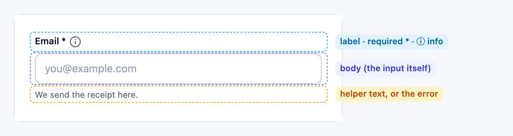

### 5.1 Options shared by every control (`ControlOptions<V>`)

| Option | Type | Default | Notes |
| --- | --- | --- | --- |
| `name` | `string` | **required** | Key in submitted data. Must match `/^[A-Za-z][A-Za-z0-9_.-]{0,63}$/` and be unique in a `Form`. |
| `label` | `string` | `''` | Shown above the control (inline for checkbox/switch). Also the screen-reader name. |
| `helperText` | `string` | `''` | Grey line below. Replaced by the error message while invalid. |
| `info` | `string` | `''` | Shows an ⓘ icon next to the label. Its tooltip opens on hover (mouse), tap (touch) or **F1** while the control is focused; Esc closes it. Also read by screen readers. Change later with `control.infoText = '...'`. |
| `disabled` | `boolean` | `false` | Also settable later via `control.enabled = false`. |
| `required` | `boolean` | `false` | Adds `*` to the label and fails validation when `isEmpty()`. |
| `requiredMessage` | `string` | `"<Label> is required."` | |
| `validators` | `Validator<V>[]` | `[]` | See [§7](#7-validation). |
| `validateOn` | `'blur' \| 'change' \| 'submit'` | `'blur'` | Overridden by the form's `autovalidateMode`. |
| `theme` | `DeepPartial<Theme>` | none | Per-instance style overrides ([§9](#9-styling-and-theming)). |
| `width` | `number` | `320` | Initial width; layouts call `layout(width)` anyway. |
| `tabIndex` | `number` | `0` | Positive values come first in Tab order (like HTML `tabindex`). |

### 5.2 Members shared by every control

```ts
control.getValue(); control.setValue(v, emit = true); control.reset(); control.isEmpty();
control.validate(): Promise<string | null>;   control.setError(msg | null);   control.error;
control.focus(); control.blur(); control.focused; control.enabled = false;
control.fieldLabel = 'New label'; control.helperText = '...'; control.infoText = '...';
control.layout(width); control.layoutHeight;   control.setThemeOverride({...});
control.fieldName; control.touched; control.validateOn; control.wipe();
```

**Events** (`control.on(event, handler)`):

| Event | Arguments | When |
| --- | --- | --- |
| `change` | `(value, control)` | Value changed by the user or `setValue(v, true)` |
| `input` | `(control)` | Text fields: every edit |
| `submit` | `(control)` | Text fields: Enter (single-line) or Ctrl/Cmd+Enter (multi-line) |
| `focus` / `blur` | `(control)` | Focus changes |
| `validate` | `(error \| null)` | Error state changed |
| `resize` | `(control)` | Height changed (e.g. an error appeared); layouts listen for this |
| `press` | `(button)` | `Button` only |
| `complete` | `(value, control)` | `OtpInput` only: every box filled |

### 5.3 `TextInput` and `TextArea`

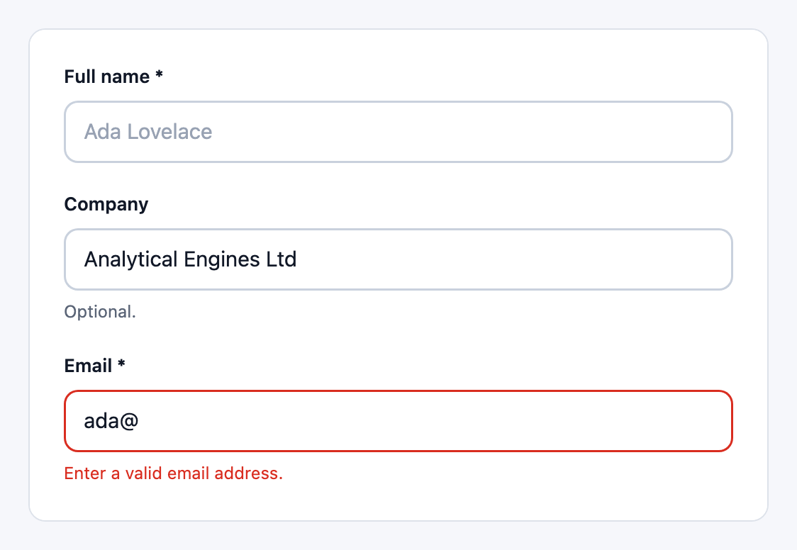

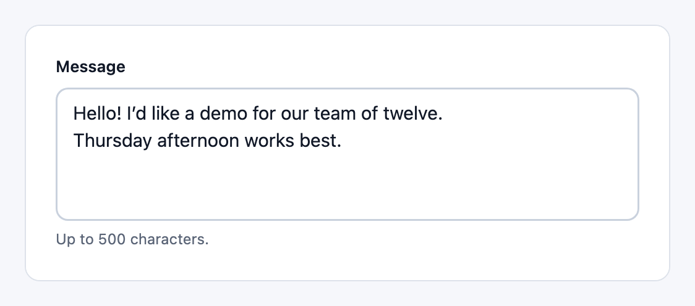

```ts
new TextInput(ui, { name: 'city', label: 'City', placeholder: 'Jaipur', maxLength: 60 });
new TextArea(ui, { name: 'notes', label: 'Notes', rows: 5, showCounter: true, maxLength: 1000 });
```

| Option | Type | Default | Notes |
| --- | --- | --- | --- |
| `value` | `string` | `''` | Initial value (sanitised). `reset()` returns to it. |
| `placeholder` | `string` | `''` | |
| `maxLength` | `number` | 256 / 2000 (textarea) | In code points. Hard ceiling 20,000. |
| `allow` | `RegExp` | none | Per-character allow-list applied while typing and pasting. |
| `formatters` | `TextInputFormatter[]` | `[]` | See [§8](#8-input-formatting-and-sanitisation). |
| `rows` | `number` | 4 | `TextArea` only. |
| `readOnly` | `boolean` | `false` | Selectable and copyable, not editable. |
| `showCounter` | `boolean` | `false` | `n/max` at bottom right. |
| `inputMode` | `'text' \| 'email' \| 'tel' \| 'numeric' \| 'decimal' \| 'url' \| 'search'` | `'text'` | Mobile keyboard layout. |
| `enterKeyHint` | `'enter' \| 'done' \| 'go' \| 'next' \| 'previous' \| 'search' \| 'send'` | `'next'` | Mobile Enter key label. |
| `normalize` | `'NFC' \| 'NFKC' \| false` | `'NFC'` | Unicode normalisation. |
| `enableInteractiveSelection` | `boolean` | `true` | `false` disables selection and copy/cut (Flutter equivalent). |

Extra members: `length`, `getSelection()`, `setSelection(start, end)`, `selectAll()`, `undo()`, `redo()`,
`readOnly`, `placeholder`, `showCounter`.

**Keyboard:**

| Keys | Action |
| --- | --- |
| ← → | Move caret (collapses a selection) |
| Ctrl+← → (Win/Linux), ⌥← → (Mac) | Move by word |
| ⌘← → (Mac), Home/End | Line start/end; Ctrl+Home/End jumps to document start/end in `TextArea` |
| Shift + any movement | Extend the selection |
| ↑ ↓, PageUp/PageDown | `TextArea`: move by line/page, keeping the column |
| Backspace / Delete (+ Ctrl/⌥ for a word, ⌘⌫ to line start) | Delete |
| Ctrl/⌘+A, Ctrl/⌘+Z, Ctrl+Y / ⇧⌘Z | Select all, undo, redo |
| Ctrl/⌘+C / X / V | Copy / cut / paste (through the system clipboard) |
| Enter | `TextInput`: emits `submit`. `TextArea`: new line (Ctrl/⌘+Enter submits). |
| Esc | Collapse the selection |

Pointer: click to place the caret, drag to select (mouse/pen), double-click selects a word, triple-click selects all.

### 5.4 `PasswordInput`

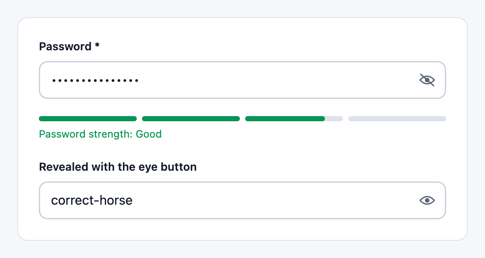

```ts
const pw = new PasswordInput(ui, { name: 'password', label: 'Password', required: true });
pw.on('change', (s: Secret) => meter.update(s));
```

Inherits the text options except `multiline`/`rows`. Defaults: `maxLength: 128`, `normalize: 'NFKC'`.

| Option | Default | Notes |
| --- | --- | --- |
| `showVisibilityToggle` | `true` | Eye button. |
| `revealTimeoutMs` | `10000` | Auto re-obscure. `0` = never. |
| `revealLastChar` | `'auto'` | Briefly show the last typed character: `'auto'` = touch devices only, or `true`/`false`. |
| `revealLastCharMs` | `1000` | |
| `obscuringCharacter` | `'•'` | |
| `allowPaste` | `true` | Keep it on so password managers work via paste. |
| `capsLockWarning` | `true` | Helper line shows "Caps Lock is on". |

Built-in behaviour: copy/cut blocked, no undo history, word navigation jumps to the ends, re-obscured on blur
and when the tab is hidden, and the proxy switches to `type=password` (keyboards don't learn the value).
Extra members: `isRevealed`, `setRevealed(bool)`.

### 5.5 `Checkbox`

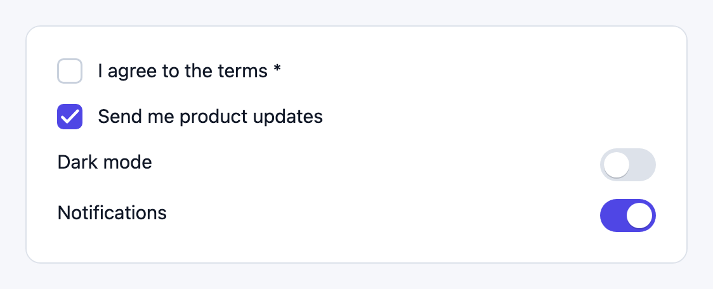

```ts
new Checkbox(ui, { name: 'terms', label: 'I accept the terms', required: true, requiredMessage: 'Please accept.' });
```

Options: `checked`, `indeterminate` (shows a dash; cleared on next toggle). `required` means "must be checked".
Members: `toggle()`. Keyboard: Space.

### 5.6 `Switch`

```ts
new Switch(ui, { name: 'alerts', label: 'Security alerts', description: 'Email me about new sign-ins.', value: true });
```

Laid out like a list tile (text on the left, switch on the right). Options: `value`, `description`.
Members: `toggle()`. Keyboard: Space/Enter toggle, ← off, → on.

### 5.7 `RadioGroup<T>`

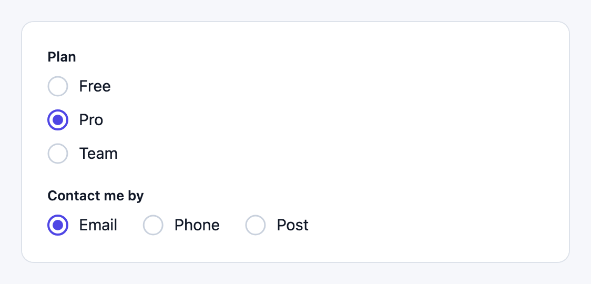

```ts
new RadioGroup(ui, {
  name: 'plan', label: 'Plan', direction: 'horizontal', value: 'free',
  options: [{ value: 'free', label: 'Free' }, { value: 'pro', label: 'Pro' }, { value: 'team', label: 'Team', disabled: true }],
});
```

One Tab stop for the whole group. ↑ ↓ ← → move **and** select (skipping disabled options); Space selects.
Horizontal groups wrap to new rows when narrow. `setValue()` ignores values that aren't declared options.

### 5.8 `Select<T>`

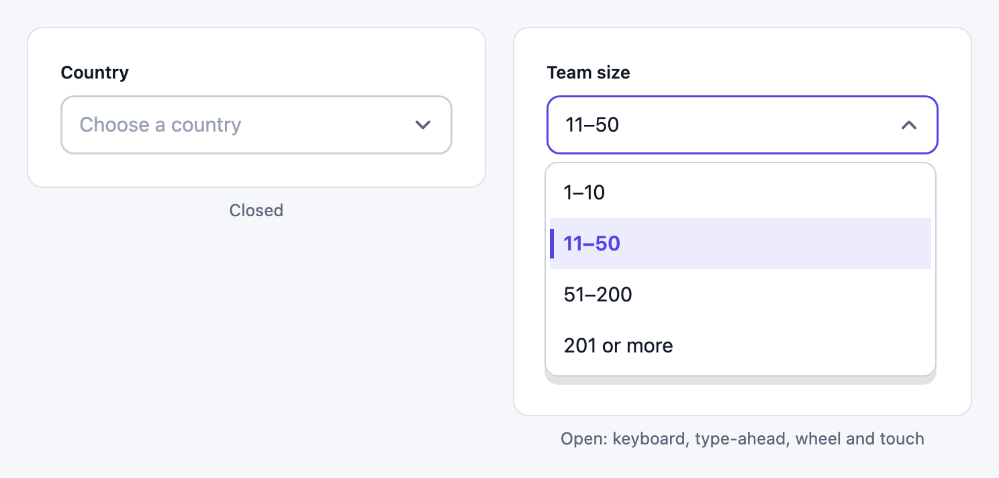

```ts
new Select(ui, { name: 'country', label: 'Country', placeholder: 'Choose…', options: [{ value: 'IN', label: 'India' }, ...] });
```

The menu opens in `ui.overlay`, flips above the field when there's no room below, follows the field while
scrolling, and scrolls by wheel or touch drag (shows `dropdownMaxVisible` rows).

| Keys (closed) | Action | Keys (open) | Action |
| --- | --- | --- | --- |
| Enter / Space / Alt+↓ | Open | ↑ ↓ Home End | Move highlight |
| ↑ ↓ | Change value directly | Enter / Space | Choose |
| Letters | Type-ahead select | Letters | Type-ahead highlight |
| | | Esc | Close |
| | | Tab | Close and move on |

Members: `isOpen`, `setOpen(bool)`.

### 5.9 `Slider`

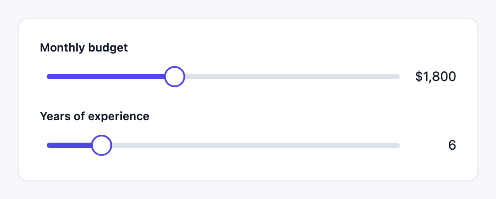

```ts
new Slider(ui, { name: 'age', label: 'Age', min: 18, max: 99, step: 1, value: 30, format: (v) => `${v} yrs` });
```

Options: `min` (0), `max` (100), `step` (1), `value`, `format`, `showValue` (true).
Keyboard: arrows ±step, PageUp/PageDown ±10%, Home/End min/max. Dragging captures the pointer, so
a scroll view won't pan while you drag the thumb.

### 5.10 `Button`

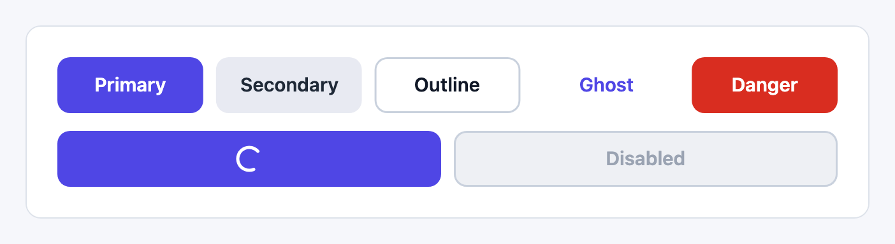

```ts
new Button(ui, { name: 'save', text: 'Save', variant: 'primary', onPress: async () => { await save(); } });
```

| Option | Default | Notes |
| --- | --- | --- |
| `text` | **required** | |
| `variant` | `'primary'` | `'primary' \| 'secondary' \| 'outline' \| 'ghost' \| 'danger'` |
| `block` | `true` | Fill the width; `false` sizes to the text. |
| `onPress` | none | If it returns a Promise, the button shows a spinner and ignores presses until it settles. |

Members: `text`, `variant`, `loading`, `press()`. Keyboard: Enter/Space (key repeat ignored).

### 5.11 `OtpInput`

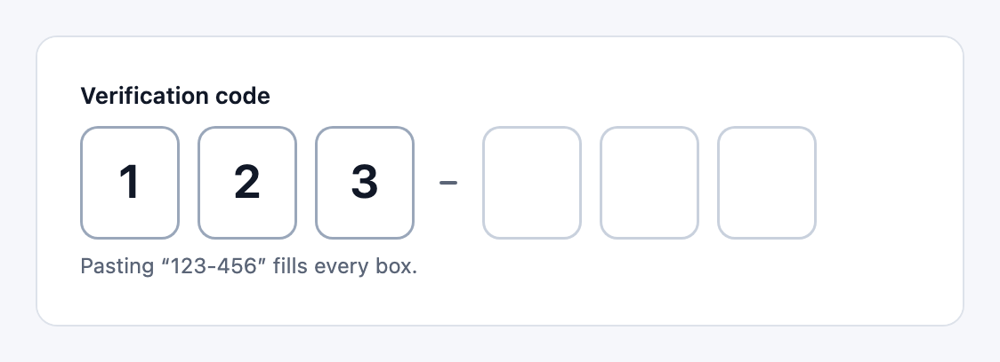

```ts
const otp = new OtpInput(ui, {
  name: 'code', label: 'Verification code', required: true,
  length: 6, groupSize: 3, autoSubmit: true, webOtp: true,
  info: 'The code arrives by SMS.',
});
otp.on('complete', (code) => console.log('all digits entered'));
```

| Option | Default | Notes |
| --- | --- | --- |
| `length` | `6` | Number of digit boxes, 4–10. |
| `groupSize` | `0` | Visual grouping with a dash, e.g. `3` → `123 – 456`. |
| `obscure` | `false` | Show `•` instead of digits. |
| `autoSubmit` | `false` | Emits `submit` when the last box is filled, so a bound `Form` submits immediately. |
| `webOtp` | `false` | Android Chrome: reads the code from an incoming SMS with the WebOTP API. The SMS must end with `@your.domain #123456`. |
| `value` | `''` | Initial digits. |

Behaviour:

- **Digits only.** Anything else is rejected with a short shake. Full-width digits (`１２３`) are normalised.
- **Paste and autofill.** A full-length code (`123-456`, `123 456`, from SMS autofill or paste) replaces all boxes
  at once. Separators are stripped.
- **Mobile.** Numeric keypad (`inputMode: 'numeric'`) and `autocomplete="one-time-code"`, so iOS and Android offer
  the code from SMS above the keyboard.
- **Editing.** Typing overwrites at the caret and advances. Backspace deletes back; ← → Home End move; Ctrl/⌘+Backspace
  clears to the start; Esc clears everything; Enter submits.
- **Validation.** A partially filled code shows "Enter all N digits." `required` handles the empty case.
- **Errors.** Server errors (e.g. "Incorrect code. 4 attempts left.") turn all boxes red and shake the group.
- **Security.** Digits live in a `SecureBuffer`; copy/cut are blocked; `sensitive = true`, so `Form.wipeSecrets()`
  clears the code after every submit attempt.

Members: `length`, `isComplete`, `clear()`, `obscure`, `autoSubmit`.

### 5.12 `DatePicker` (calendar with optional time)

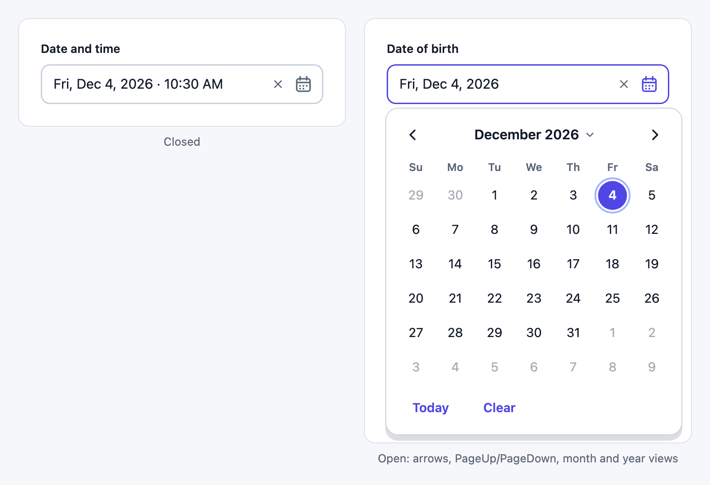

```ts
const dob = new DatePicker(ui, {
  name: 'dateOfBirth', label: 'Date of birth', required: true,
  max: 'today', min: '1900-01-01',
});
const meeting = new DatePicker(ui, {
  name: 'meeting', label: 'Meeting',
  min: 'today', max: 'today+60',
  time: { step: 30, hour12: false, defaultTime: '10:00' },
  isDateDisabled: (iso) => [0, 6].includes(new Date(iso + 'T00:00').getDay()), // no weekends
});
meeting.getValue();   // '2026-11-24T10:30'
meeting.getDate();    // JS Date in local time
```

| Option | Default | Notes |
| --- | --- | --- |
| `value` | `null` | `'YYYY-MM-DD'` or `'YYYY-MM-DDTHH:mm'`. Invalid dates (e.g. `2026-02-30`) are ignored. |
| `min` / `max` | none | ISO date, `'today'`, or `'today±N'` days. Out-of-range days are struck through. |
| `isDateDisabled` | none | `(isoDate) => boolean` for weekends, holidays, booked days. |
| `time` | `false` | `true` or `{ step = 15, hour12 = locale, defaultTime = '09:00' }`. Adds an hour/minute (and AM/PM) row. |
| `locale` | browser | Month and day names, formats, and the default week start. |
| `firstDayOfWeek` | locale | 0 = Sunday … 6 = Saturday. |
| `placeholder` | "Select a date" | |
| `clearable` | `!required` | × in the field and a Clear button in the popup. |

**Popup:** month grid with ‹ › arrows; click the title for a month view, and again for a year view (12 years per
page), so a date of birth takes a few clicks. "Today" jumps and selects; with time, picking a day keeps the popup
open until **Done**. The popup flips above the field and stays on screen on phones.

| Keys (popup open) | Action |
| --- | --- |
| ← → ↑ ↓ | Previous/next day, previous/next week |
| PageUp / PageDown | Previous/next month (with Shift: year) |
| Home / End | Start/end of the week |
| T | Today |
| Enter / Space | Choose the highlighted date (month/year in those views) |
| Tab / Shift+Tab | Calendar → hour → minute → AM/PM (time mode) |
| ↑ ↓ or digits (time) | Change hour/minute; A/P sets AM/PM; Enter closes |
| Esc | Back from month/year view, or close |

Closed: Enter / Space / Alt+↓ / F4 opens; Delete or Backspace clears. Screen readers hear the full date
("Tuesday, 24 November 2026, 11:30"), whether it's unavailable or selected, and month changes.

Values are plain local strings with no timezone, so the browser and the server always agree on the day. If you need
an instant in time, combine the value with the user's timezone on the server.

### 5.13 `PhoneInput` (number with country code)

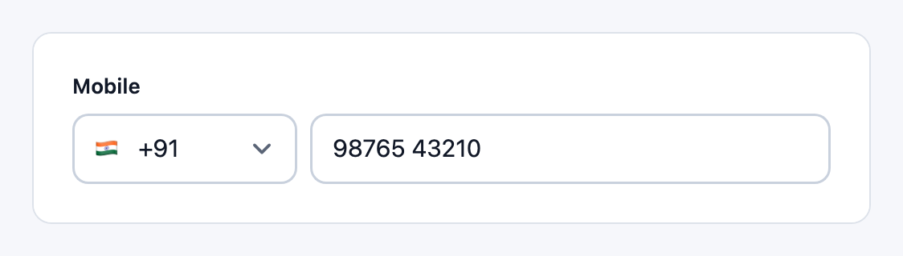

```ts
const phone = new PhoneInput(ui, {
  name: 'phone', label: 'Mobile', required: true,
  defaultCountry: 'IN',
  preferredCountries: ['IN', 'US', 'GB'],
});
phone.getValue();   // '+919876543210'
phone.getParts();   // { country: { iso: 'IN', dial: '91', … }, national: '9876543210', e164: '+919876543210' }
```

| Option | Default | Notes |
| --- | --- | --- |
| `defaultCountry` | browser region, else `US` | ISO 3166 code. |
| `preferredCountries` | `[]` | Shown first in the menu. |
| `onlyCountries` | all | Restrict the list. |
| `countries` | built-in ~40 | Your own `Country[]` (`iso`, `name`, `dial`, `pattern`, `min`, `max`, `trunk`). |
| `showFlags` | on, except Windows | Windows has no flag emoji; the ISO code is shown instead. |
| `value` | `''` | E.164; the country is detected from it. |

Behaviour:

- **Two tab stops in one field:** the country menu (type-ahead: "uni" → United…), then the number. One label, one
  error message; both parts turn red when invalid.
- **Live formatting** with the country's pattern: `98765 43210`, `(201) 555-0123`, `7911 123456`.
- **International input:** pasting or autofilling `+44 7911 123456` / `0044…`, or typing `+44…`, switches the country.
  The longest dial code wins, and the current country is kept for shared codes (+1 US/CA).
- **Domestic prefix:** a leading trunk `0` (or `8` for Russia) is dropped.
- **Validation:** national length must fit the country ("Enter a valid India number (10 digits)."), and the result
  is always valid E.164, matching the shared `phone` rule on the server.
- **Screen readers:** the number part is announced with its country ("Mobile, United Kingdom +44").

Members: `countryField` (a `Select`), `numberField` (a `TextInput`), `getParts()`. Exported data:
`PHONE_COUNTRIES`, `formatNational()`, `flagEmoji()`.

---

## 6. The Form controller

```ts
const form = new Form(ui, {
  onSubmit,                                 // required
  autovalidateMode: 'onUserInteraction',    // 'disabled' | 'onUserInteraction' | 'always'
  rateLimit: { maxAttempts: 5, windowMs: 60_000, lockoutMs: 15_000, maxLockoutMs: 900_000 }, // or false
  botGuard: { minFillMs: 2000, minInteractions: 3 },                                           // or false
  idleTimeoutMs: 5 * 60_000,                // wipe secrets after inactivity; 0 = off
  wipeSecrets: 'always',                    // 'always' | 'success' | 'never'
});
```

### onSubmit contract

```ts
type SubmitResult = { ok: boolean; message?: string; fieldErrors?: Record<string, string> };
onSubmit: (values: FormValues, form: Form) => SubmitResult | void | Promise<SubmitResult | void>;
```

- `values` is an object keyed by control `name` (buttons excluded). Secrets arrive as `Secret`.
- Return nothing to mean success. If `onSubmit` throws, the result is a generic failure, and error details are
  never shown to the user.
- `fieldErrors` keys must match control names. Each message appears on its field and the first one gets focus.

### Submit pipeline

1. Validate all controls in parallel (marks them touched). On errors: focus the first, announce, emit `invalid`.
2. Bot guard (minimum fill time, trusted interaction count). On failure: emit `blocked`.
3. Client rate limit. On failure: emit `blocked` with the retry time.
4. Emit `submitting`, then call `onSubmit` (the bound button shows a spinner).
5. Apply `fieldErrors`, wipe secrets per `wipeSecrets`, reset the limiter on success, emit `success` or `failure`.

### Members and events

| Member | Purpose |
| --- | --- |
| `add(...controls)` | Register controls (throws on duplicate names). Chainable. |
| `bindSubmit(button)` | Make a button submit the form. |
| `get<T>(name)` | Look up a control. |
| `values()` | Current values. |
| `validate()` | Validate everything; returns `{ name: error }`. |
| `submit()` | Run the pipeline programmatically. |
| `wipeSecrets()` | Zero all secret fields (emits `change` on them). |
| `reset()` | Reset all controls and wipe secrets. |
| `isSubmitting` | Whether a submit is in flight. |
| `destroy()` | Remove listeners and wipe. |

Events: `submitting`, `success(result)`, `failure(result)`, `invalid(errors)`, `blocked(reason)`, `idle`.

---

## 7. Validation

### 7.1 Validators

```ts
type Validator<V> = (value: V, ctx: ValidationContext) => string | null | undefined | Promise<...>;
interface ValidationContext { control: Control<unknown>; getField?: (name: string) => Control<unknown> | undefined }
```

Return an error message, or `null`/`undefined` when valid. Validators run in order and stop at the first error.
`required` is checked before any validator.

```ts
new TextInput(ui, {
  name: 'username', label: 'Username', required: true,
  validators: [
    (v) => (/^[a-z][a-z0-9_]{2,23}$/.test(v) ? null : 'Use 3–24 lowercase letters, digits or _.'),
    async (v) => ((await api.isTaken(v)) ? 'That username is taken.' : null),
  ],
});
```

- **Async:** if the value changes while a check is in flight, the stale result is discarded.
- **Exceptions:** a throwing validator shows "Could not validate this field." and never leaks error details.
- **Cross-field:** use `ctx.getField(name)` (available once the control belongs to a `Form`).

```ts
const matchesPassword: Validator<Secret> = (v, ctx) => {
  const other = ctx.getField?.('password')?.getValue();
  return other instanceof Secret && !v.equals(other) ? 'Passwords do not match.' : null;
};
```

### 7.2 When validation runs

| `autovalidateMode` (Form) | Behaviour |
| --- | --- |
| `'onUserInteraction'` (default) | Each control uses its `validateOn` (`'blur'` by default). Once a touched field shows an error, it re-validates on every change so the error clears as soon as it's fixed. |
| `'always'` | Validate on every change, from the start. |
| `'disabled'` | Only on submit. |

Call `control.validate()` yourself to re-check a dependent field, e.g. revalidate "confirm password" when
"password" changes (the demo does this).

### 7.3 Validators from shared rules

`fromRule(rules, name)` returns options including a validator built from the rule, so the browser runs the same
checks as the server. See [§13](#13-shared-rules).

### 7.4 Business rules and custom error messages

There are three places for a check. Pick by what the check needs to know:

| The check needs… | Put it in | Message appears |
| --- | --- | --- |
| Only this field's value (format, length, "no spaces") | `validators` on the field | Under the field, when it's left and on submit |
| Another field too (end date after start date, matching passwords) | a validator using `ctx.getField(name)` | Under the field |
| The whole form, your server or a database (reserved or taken names, stock, limits) | `onSubmit`, returning `fieldErrors` | Under each named field; the first gets focus |

On submit, every field's validators run first. `onSubmit` is only called once they all pass, so it never sees a
value that breaks a field rule.

**Several checks on one field.** List them in order. They stop at the first failure, so put the most helpful
message first:

```ts
{
  type: 'text', name: 'username', label: 'Username', required: true, maxLength: 24,
  validators: [
    (v) => (/\s/.test(v) ? 'Usernames can’t contain spaces. Try ada_l instead of ada l.' : null),
    (v) => (v.length >= 3 ? null : 'Use at least 3 characters.'),
    (v) => (/^[a-z]/.test(v) ? null : 'Start with a lowercase letter.'),
    (v) => (/^[a-z0-9_]+$/.test(v) ? null : 'Use only lowercase letters, digits and _.'),
    async (v) => ((await api.isTaken(v)) ? 'That username is taken.' : null), // async works too
  ],
}
```

**Business rules on submit.** Return `ok: false` with `fieldErrors` keyed by field name. Nothing is sent, and each
message appears on its field:

```ts
const RESERVED = new Set(['admin', 'root', 'support']);

mountPixiForm(host, {
  fields,
  onSubmit: async (values) => {
    const errors: Record<string, string> = {};
    if (RESERVED.has(String(values.username))) errors.username = 'That username is reserved. Please choose another.';
    if (values.plan === 'team' && Number(values.seats) < 2) errors.seats = 'Team plans need at least 2 seats.';
    if (Object.keys(errors).length) return { ok: false, message: 'Please fix the highlighted fields.', fieldErrors: errors };

    // Your server has the final say: pass its field errors straight through.
    const res = await fetch('/api/signup', { method: 'POST', headers: { 'Content-Type': 'application/json' }, body: JSON.stringify(values) });
    const data = await res.json();
    return res.ok ? { ok: true, message: 'Account created.' } : { ok: false, message: data.message, fieldErrors: data.fieldErrors };
  },
});
```

The live demo on the home page does both: type `ada l` in Username for a field check, or `admin` for the submit
rule.

**Always repeat the rules on the server.** Browser checks give fast feedback, but anyone can skip them. Keep the
rules in one shared file ([§13](#13-shared-rules)) so the browser and the server can't drift apart.

---

## 8. Input formatting and sanitisation

Every insertion (typing, paste, IME commit) passes through this pipeline:

```
raw text ─► formatters (yours, in order) ─► sanitizeInput() ─► allow regex ─► maxLength cap ─► SecureBuffer
```

### 8.1 Formatters

```ts
type TextInputFormatter = (inserted: string, ctx: { before: string; after: string }) => string;
```

`before`/`after` are the text around the insertion point (always empty for secret fields, so formatters can
never see a password). Built-ins:

| Formatter | Effect |
| --- | --- |
| `Formatters.allow(re)` / `Formatters.deny(re)` | Keep / drop characters matching `re` |
| `Formatters.digitsOnly()` | `0-9` only |
| `Formatters.upperCase()` / `lowerCase()` | Case conversion |
| `Formatters.singleSpaces()` | No leading spaces, no runs of spaces |
| `Formatters.noMarkup()` | Drops `<`, `>` and backticks |

Custom example, card-number grouping:

```ts
const groupDigits: TextInputFormatter = (s, { before }) => {
  let out = '';
  let count = before.replace(/\D/g, '').length;
  for (const ch of s.replace(/\D/g, '')) {
    if (count > 0 && count % 4 === 0) out += ' ';
    out += ch;
    count++;
  }
  return out;
};
```

### 8.2 What the sanitiser always removes

`sanitizeInput()` runs after your formatters and can't be disabled:

- C0/C1 control characters (keeps `\n` in `TextArea`; tabs become spaces).
- Bidirectional overrides and isolates (U+202A–U+202E, U+2066–U+2069, …), used in "Trojan Source" spoofing.
- Zero-width and invisible characters (ZWSP, ZWNJ, BOM, soft hyphen, …). ZWJ is kept so emoji sequences survive.
- Unpaired surrogates.
- Input over 20,000 characters is truncated **before** processing (stops huge-paste attacks).
- Then Unicode normalisation (NFC by default; NFKC for passwords).

You can call `sanitizeInput(text, { multiline, allow, maxCodePoints, normalize })` yourself for other untrusted text.

---

## 9. Styling and theming

All styling is done with **theme tokens**, not CSS. Themes are frozen objects; overrides are deep-merged.

### 9.1 Palette API: theme, text and accent colours

The quickest way to brand a form is to describe it with **three colour groups**. `createFormTheme()` derives every
other token from them: hover and pressed shades, focus ring, selection, tracks, disabled and placeholder text, and a
contrast-safe text colour on the accent.

```ts
import { createFormTheme, checkContrast } from './lib';

const theme = createFormTheme(
  {
    mode: 'light',                        // base for anything not given ('light' | 'dark')
    theme: {                              // "theme colors": surfaces and lines
      background: 0xf5f7fb,               //   page / canvas
      surface: 0xffffff,                  //   fields, cards, menus
      border: 0xd0d7e2,                   //   field borders (borderHover is derived)
    },
    text: {                               // "text colors"
      primary: 0x0f172a,                  //   values and labels
      secondary: 0x475569,                //   helper text, descriptions, icons
      // disabled, placeholder and onAccent are derived if omitted
    },
    accent: {                             // "accent colors" (or just: accent: 0x0f766e)
      base: 0x0f766e,                     //   buttons, focus border, checked states
      // hover, pressed, focusRing, selection, caret are derived if omitted
    },
    status: { error: 0xc81e1e },          // optional: error, warning, success
  },
  { radius: 12, fontSize: 16 },           // optional non-colour tokens
);

console.warn(checkContrast(theme));       // [] when every text pair meets WCAG AA
new FormUI(app, { theme });
```

| Group | Keys | Derived when omitted |
| --- | --- | --- |
| `theme` | `background`, `surface`, `border`, `borderHover`, `shadow` | `borderHover` from border + text; hover and disabled surfaces; tracks |
| `text` | `primary`, `secondary`, `disabled`, `placeholder`, `onAccent` | `secondary` from primary; disabled and placeholder by blending with the surface; `onAccent` = white or near-black, whichever contrasts better |
| `accent` | `base`, `hover`, `pressed`, `focusRing`, `selection`, `caret` | Shades of `base` (lighter in dark mode, darker in light mode) |
| `status` | `error`, `warning`, `success` | Base theme's values |

**Presets:** `presetTheme(name, mode)` with `name` from `accentPalettes`: `indigo`, `teal`, `rose`, `amber`,
`violet`, `slate`. Each has a tuned light and dark accent. The demo's app-bar swatches use these.

```ts
ui.setTheme(presetTheme('teal', 'dark'));
```

**Contrast helpers:** `contrastRatio(a, b)`, `luminance(c)`, `readableOn(bg)`, and `checkContrast(theme)`, which
checks text, helper, button, error and focus colours against WCAG AA and lists any failures.

### 9.2 Four levels of control

```ts
import { lightTheme, darkTheme, createTheme, themeFromSeed } from './lib';

// 1. Choose a base, or derive one from your brand colour
const ui = new FormUI(app, { theme: themeFromSeed(0x0f766e) });

// 2. Override any token globally
const brand = createTheme(lightTheme, {
  fontFamily: ['Inter', 'system-ui', 'sans-serif'],
  radius: 14, controlHeight: 52, buttonRadius: 26, borderWidth: 2,
  colors: { primary: 0xe11d48, primaryHover: 0xbe123c, borderFocus: 0xe11d48, focusRing: 0xfda4af, caret: 0xe11d48 },
});
const ui2 = new FormUI(app, { theme: brand });   // or: new FormUI(app, { theme: lightTheme, themeOverrides: {...} })

// 3. Switch at runtime: every control redraws
ui.setTheme(darkTheme);
app.renderer.background.color = darkTheme.colors.background;

// 4. Per-control overrides
new Button(ui, { name: 'delete', text: 'Delete account', variant: 'danger', theme: { buttonRadius: 4 } });
otp.setThemeOverride({ fontFamily: ['ui-monospace', 'monospace'], fontSize: 22 });
```

Per-control overrides stay in effect across `setTheme()` calls: they're re-applied on top of the new base.

### 9.3 Size and typography tokens

| Token | Light/dark default | Used by |
| --- | --- | --- |
| `fontFamily` | system-ui stack | All text |
| `fontSize` / `fontWeight` | 15 / 400 | Field text, labels of inline controls |
| `labelFontSize` / `labelFontWeight` | 13 / 600 | Labels above controls |
| `helperFontSize` | 12 | Helper and error lines, counters |
| `titleFontSize` | 22 | `Label` title variant |
| `lineHeight` | 1.45 | Multiplier for all text |
| `radius` | 10 | Fields, select, menus |
| `borderWidth` | 1.5 | Field borders |
| `controlHeight` | 44 | `TextInput`, `PasswordInput`, `Select` |
| `paddingX` / `paddingY` | 14 / 10 | Text inside fields |
| `labelGap` / `helperGap` | 7 / 6 | Label→field, field→helper spacing |
| `focusRingWidth` / `focusRingOffset` | 3 / 2 | Keyboard focus ring |
| `buttonHeight` / `buttonRadius` | 44 / 10 | `Button` |
| `checkboxSize` | 20 | Checkbox and radio |
| `toggleWidth` / `toggleHeight` | 44 / 26 | `Switch` |
| `sliderTrackHeight` / `sliderThumbSize` | 6 / 22 | `Slider` |
| `caretWidth` / `caretBlinkMs` | 1.5 / 530 | Text caret |
| `dropdownItemHeight` / `dropdownMaxVisible` | 38 / 6 | `Select` menu |
| `animationSpeed` | 0.25 | Checkbox/switch/radio/meter animations (0–1) |

### 9.4 Colour tokens

Colours are numbers (`0xRRGGBB`).

| Group | Tokens |
| --- | --- |
| Surfaces | `background`, `surface`, `surfaceHover`, `surfaceDisabled`, `overlay`, `shadow` |
| Borders and focus | `border`, `borderHover`, `borderFocus`, `focusRing` |
| Text | `text`, `textMuted`, `textDisabled`, `placeholder` |
| Brand | `primary`, `primaryHover`, `primaryPressed`, `primaryText` |
| Secondary buttons | `secondary`, `secondaryHover`, `secondaryText` |
| Status | `error`, `warning`, `success` |
| Editing | `selection`, `caret` |
| Range controls | `track`, `thumb` |
| Inverse (toast, privacy screen) | `inverseSurface`, `inverseText` |

Utilities: `mix(a, b, t)` blends two colours; `themeFromSeed(seed, dark?)` derives primary, hover, pressed,
focus and selection colours from one brand colour.

### 9.5 Fonts

Canvas text needs fonts that are **already loaded** when measured:

```css
/* public/fonts.css (same origin: the CSP allows font-src 'self') */
@font-face { font-family: 'Inter'; src: url('/fonts/Inter.woff2') format('woff2'); font-display: block; }
```

```ts
await document.fonts.load('15px Inter');
await document.fonts.ready;
const ui = new FormUI(app, { theme: createTheme(lightTheme, { fontFamily: ['Inter', 'system-ui', 'sans-serif'] }) });
```

If you swap fonts after creating the UI, call `ui.setTheme(ui.theme)` to re-measure.

### 9.6 Dark mode

```ts
const mq = matchMedia('(prefers-color-scheme: dark)');
const apply = () => {
  const t = presetTheme('indigo', mq.matches ? 'dark' : 'light');   // or darkTheme / lightTheme
  ui.setTheme(t);
  app.renderer.background.color = t.colors.background;
};
mq.addEventListener('change', apply);
```

### 9.7 Changing how a built-in control draws

Subclass it and override the protected hooks:

| Hook | Purpose |
| --- | --- |
| `drawBody()` | Repaint the body. Call `super.drawBody()` first to add decorations. |
| `drawTrailing(w, h)` | Text fields: draw an icon on the right; reserve space with `this.trailingWidth = 36`. |
| `handleTrailingClick(e)` | Text fields: handle clicks there; return `true` if consumed. |
| `footerMessage()` / `footerColor()` | Customise the helper line (text and colour). |
| `drawFocus(x, y, w, h, r)` | Draw the standard focus ring around any rectangle. |
| `placeInfo(parent, x, cy)` / `infoIconSpace()` | Place the ⓘ icon in an inline-label layout and reserve space for it (see `Checkbox`). |
| `textStyle(kind, fill?, wrapWidth?)` | Get a themed text style (`'body' \| 'label' \| 'helper'`). |

Example: a search field with a clear (×) button (also in `src/examples/SearchInput.ts`).

```ts
import { Graphics, TextInput, Icons, type FederatedPointerEvent, type TextInputOptions, type FormUI } from './lib';

export class SearchInput extends TextInput {
  private readonly clearIcon = new Graphics();
  constructor(ui: FormUI, opts: TextInputOptions) {
    super(ui, { inputMode: 'search', enterKeyHint: 'search', ...opts });
    this.trailingWidth = 36;
    this.body.addChild(this.clearIcon);
    this.redraw();
  }
  protected override drawTrailing(w: number, h: number): void {
    if (!this.clearIcon) return;                       // may run before the field exists
    this.clearIcon.clear();
    if (!this.isEmpty()) Icons.close(this.clearIcon, w - 20, h / 2, 18, this.theme.colors.textMuted);
  }
  protected override handleTrailingClick(e: FederatedPointerEvent): boolean {
    if (e.getLocalPosition(this.body).x < this.layoutWidth - 36 || this.isEmpty()) return false;
    this.setValue('');
    return true;
  }
}
```

---

## 10. Layout

PixiForm layouts are deliberately small and Flutter-like. Anything with `layout(width)` and `layoutHeight` can
take part (`Layoutable`).

### `Column(items, gap = 16, padding = insets(0))`

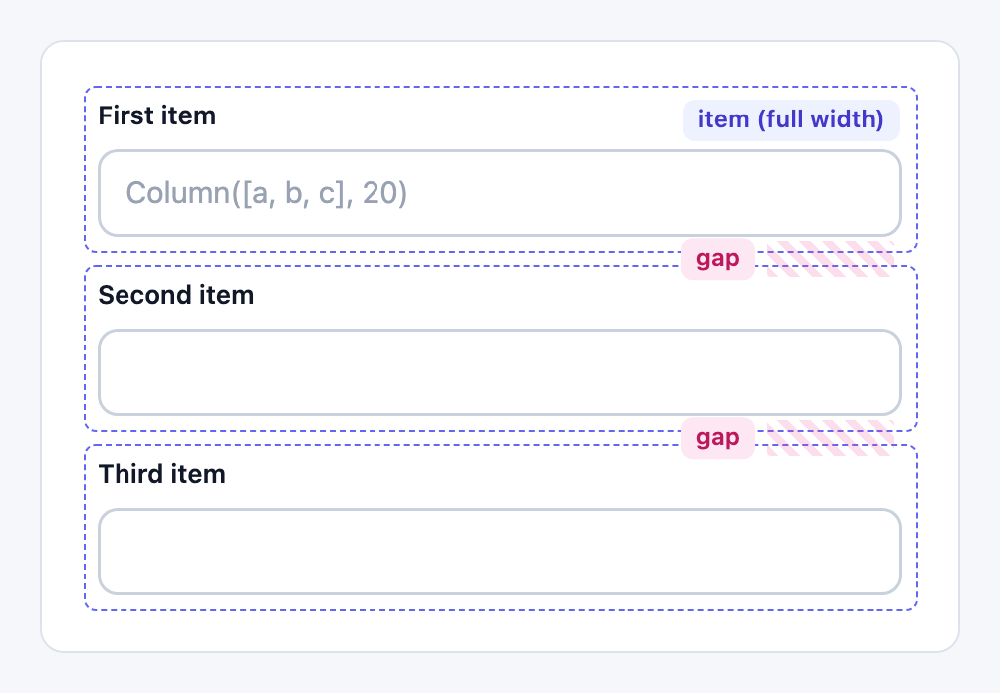

Vertical stack. Re-lays out automatically when a child emits `resize` (e.g. an error message appears).
`column.add(...items)`, `Column.spacer(height)`. Hidden children (`visible = false`) are skipped.

### `Row(items, gap = 16, breakpoint = 480)`

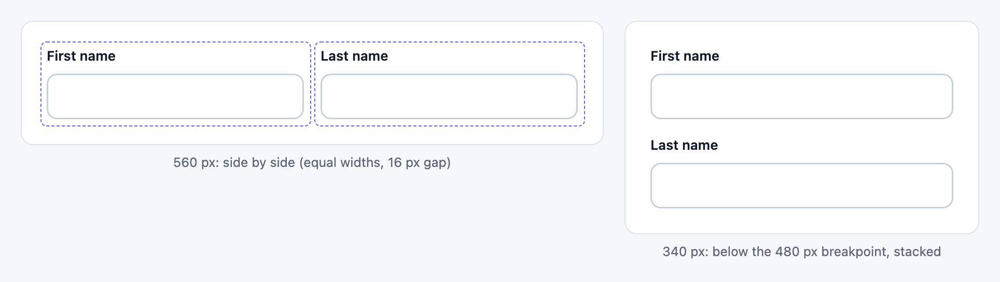

Equal-width children side by side; **stacks vertically below `breakpoint`** px. Use `breakpoint = 0` to never stack.

```ts
new Column([
  new Row([firstName, lastName], 16, 520),
  email,
  new Row([cancel, save], 12, 0),
], 20, insets(24, 16));
```

### `ScrollView(ui, content)`

Clipped viewport with wheel, touch drag with momentum, and a scrollbar. It keeps the **keyboard-focused** control
in view and re-reveals the focused field when the viewport shrinks (mobile keyboard).
Methods: `setViewport(w, h)`, `scrollTo(y)`, `reveal(container)`.

### `FieldGroup(ui, options)`: titled, optionally collapsible sections

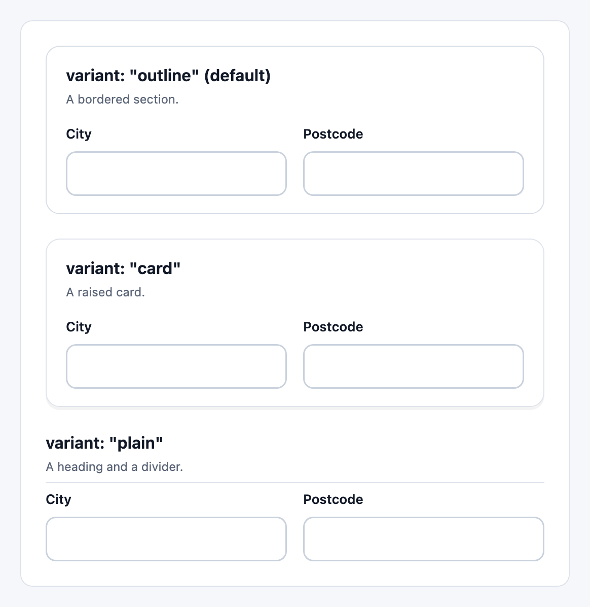

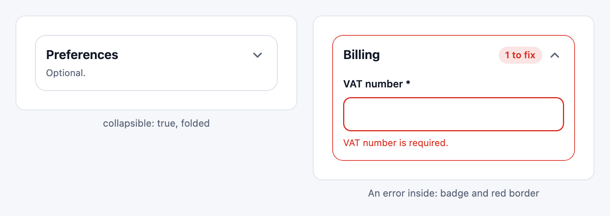

The canvas equivalent of `<fieldset>` + `<legend>`. Create it, `add()` fields (or rows, labels, nested groups),
and put the group in your layout. Grouping is visual and for accessibility only: register the fields with the
`Form` as usual, and they submit with their own flat names.

```ts
const contact = new FieldGroup(ui, {
  title: 'Contact',
  description: 'How we reach you.',
  info: 'Shown in a tooltip from the ⓘ icon.',
  collapsible: true,      // header becomes a button with a chevron
  collapsed: false,
  variant: 'outline',     // 'outline' (default) | 'card' | 'plain' (heading + divider)
}).add(new Row([email, phone], 16, 520), address);

form.add(email, phone, address);
column.add(contact);
contact.on('toggle', (expanded: boolean) => { /* … */ });
```

| Member | Purpose |
| --- | --- |
| `add(...items)` | Append layout items. |
| `expanded`, `setExpanded(b)`, `toggle()` | Fold state (non-collapsible groups are always open). |
| `title`, `description` | Live-editable header text. |
| `controls()` | Every control inside, including nested groups. |
| `errorCount` | Fields inside that currently show an error. |
| `setDisabled(b)` | Disable or enable every control inside. |

Behaviour:

- **Keyboard:** a collapsible header is a tab stop (`role="button"`, `aria-expanded`). Enter or Space toggles it,
  → opens it, ← folds it. Folded fields are skipped by Tab.
- **Errors are never hidden:** the header shows an "N to fix" badge and a red border. A folded group opens by
  itself when a field inside fails validation, so `Form.submit()` can focus the first invalid field.
- **Screen readers** hear "Contact group" when focus first moves into the group, like a fieldset legend.
- **Tab order** follows the on-screen tree order (then `tabIndex`), so it doesn't matter whether you create the group
  before or after its fields.

### `insets(vertical, horizontal = vertical, bottom = vertical, left = horizontal)`

Padding helper in the order top/right/bottom/left, like CSS shorthand.

### Custom layout containers

Implement `layout(width)` and a `layoutHeight` getter, emit `resize` when your height changes, and guard against
re-entrancy. Children emit `resize` while you lay them out:

```ts
class Card extends Container {
  private laying = false; private h = 0;
  constructor(private child: Column) { super(); this.addChild(child); child.on('resize', () => !this.laying && this.emit('resize', this)); }
  get layoutHeight() { return this.h; }
  layout(w: number) { this.laying = true; this.child.layout(w - 48); this.laying = false; this.child.position.set(24, 24); this.h = this.child.layoutHeight + 48; }
}
```

---

## 11. Widgets

| Widget | Usage |
| --- | --- |
| `Label(ui, text, variant)` | Plain-text heading or paragraph. Variants: `'title' \| 'subtitle' \| 'body' \| 'caption'`. Wraps to width. Never interprets HTML. |
| `StrengthMeter(ui)` | `meter.update(secret)` after each password change. Four animated segments plus a caption. Uses `estimateStrength()`, which reads character classes without creating strings. |
| `Toast(ui)` | `toast.show(message, 'info' \| 'success' \| 'error', ms = 4000)`. Bottom-centre, also announced to screen readers. |
| `PrivacyScreen(ui, message?)` | Covers the app when the window loses focus or the tab is hidden; renders synchronously so OS app switchers capture the cover. `privacy.enabled = false` to pause. |

**Label variants**

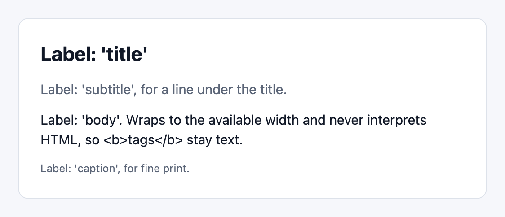

**StrengthMeter**, from too weak to strong

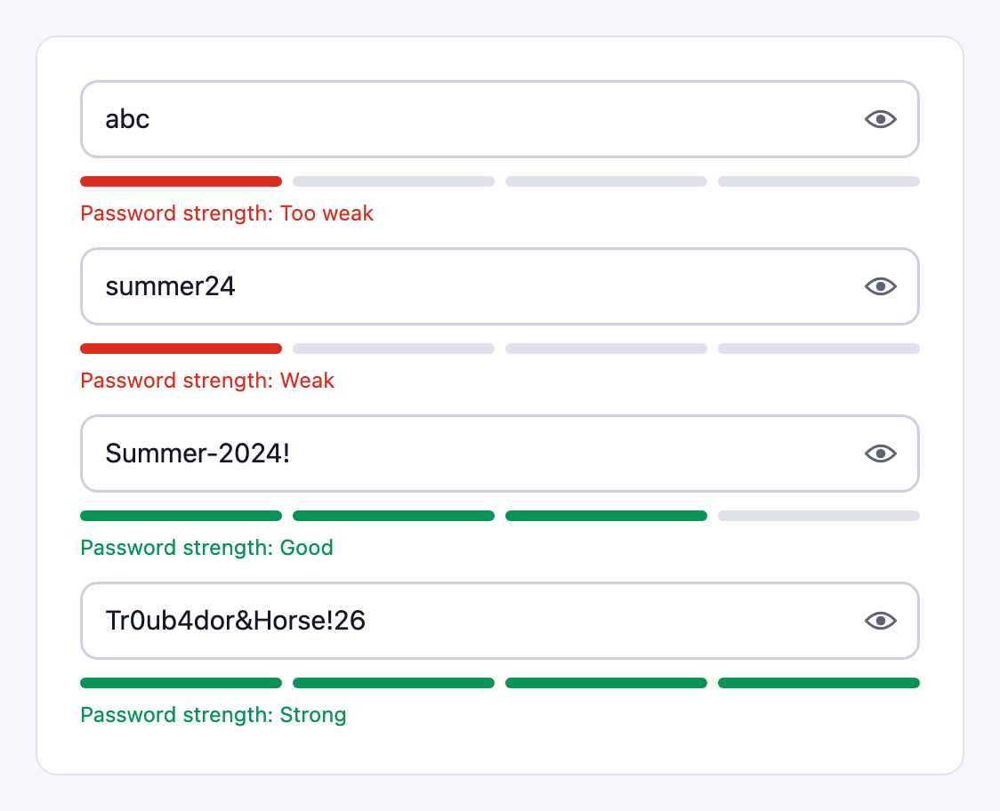

**Toast** kinds: info, success and error

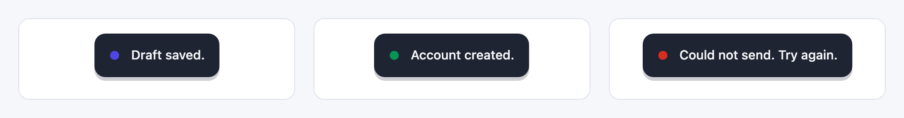

**PrivacyScreen**

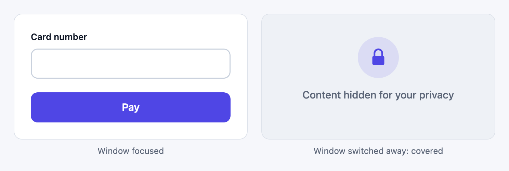

---

## 12. Extending PixiForm

### 12.1 A custom control in six methods

`src/examples/StarRating.ts` is a complete, typechecked example. The essential shape:

```ts
export class StarRating extends Control<number> {
  private value = 0;
  private readonly stars = new Graphics();

  constructor(ui: FormUI, opts: ControlOptions<number> & { value?: number }) {
    super(ui, opts);                         // label, helper, focus, theme, validation: all inherited
    this.value = opts.value ?? 0;
    this.body.addChild(this.stars);          // draw inside this.body (positioned under the label)
    this.body.eventMode = 'static';
    this.bindTap(this.body, (e) => this.setValue(Math.floor(e.getLocalPosition(this.body).x / 36) + 1));
    this.redraw();                           // ALWAYS last in the constructor
  }

  getValue() { return this.value; }
  setValue(v: number, emit = true) { this.value = v; this.drawBody(); this.ui.focus.sync(this); this.commitChange(emit); }
  reset() { this.value = 0; this.touched = false; this.setError(null); this.redraw(); }
  isEmpty() { return this.value === 0; }
  protected bodyHeight() { return 36; }
  protected drawBody() {
    if (!this.stars) return;                 // the base class may call this before your fields exist
    /* draw with this.theme.colors..., then: */
    this.drawFocus(0, 0, 180, 36, 8);
  }
}
```

### 12.2 Rules for custom controls

| Do | Why |
| --- | --- |
| Call `this.redraw()` at the end of the constructor | Field initialisers run after `super()`. |
| Guard `drawBody()` against missing fields | The base class may draw during construction. |
| Read every colour and size from `this.theme` | Global themes, `setTheme` and per-instance overrides then just work. |
| Use `this.bindTap(target, fn)` for presses | Tap-not-press semantics: correct on touch and ignores scroll gestures. |
| Call `this.commitChange(emit)` after value changes | Emits `change` and re-validates when appropriate. |
| Call `this.ui.focus.sync(this)` after state changes | Updates screen-reader state (`aria-checked`, `aria-valuenow`, …). |
| Override `ariaRole()` and `ariaState()` | Screen-reader semantics. |
| Override `handleKeyDown(e)` and return `true` when handled | Keyboard support; returning `true` prevents default. |
| Set `this.ui.focus.pointerCaptured = true` while dragging | Stops scroll views from panning during your drag. |
| Clean up tickers and timers in `destroy()` | Avoid leaks. |
| Inline label? Call `this.placeInfo(this.body, x, cy)` in `drawBody()` | Supports the `info` option (labels above get it automatically). |

### 12.3 Controls that accept text

Set `override readonly acceptsText = true` (and optionally `inputMode`, `enterKeyHint`, `secure = true`), then
implement `handleText(text)`, `handleDelete(direction)`, `handlePaste(text)` and `handleCopy(cut)`. Usually it's
simpler to extend `TextField<V>` and get caret, selection, wrapping, undo, clipboard and sanitisation for free.
Store text in a `SecureBuffer`, never in a string field.

### 12.4 Overlays and popups

Add popups to `ui.overlay` (always above `ui.content`). For modal keyboard handling, set
`ui.focus.keyInterceptor = (e) => boolean` while open and clear it on close (see `Select`).
Set `ui.focus.claimed = true` in pointer handlers on popup elements so the background click doesn't blur the control.

### 12.5 Icons

`Icons.check | dash | close | eye | chevron | errorCircle | lock | sun | moon` draw vector icons into a
`Graphics`: `Icons.eye(g, cx, cy, size, color, off)`. Add your own the same way: plain functions that draw into
a `Graphics`. Start every sub-path with `moveTo()` so it doesn't connect to the previous shape.

### 12.6 Runtime events on `FormUI`

| Event | Arguments |
| --- | --- |
| `themechange` | `(theme)` |
| `focuschange` | `(control \| null, viaKeyboard)` |
| `viewportchange` | none (mobile visual viewport resized) |
| `scroll` | `(scrollY)` emitted by `ScrollView` (closes tooltips) |

`ui.tooltip` is the shared tooltip: `show(anchor, text, owner?)`, `hide(owner?)`, `toggle(...)`, `isOpen`.
Use it for your own hints so only one bubble is ever visible.

`ui.onInteraction(fn)` subscribes to trusted user interactions (used by `Form` for bot checks and idle timers);
it returns an unsubscribe function.

---

## 13. Shared rules

`shared/rules.ts` is the single source of truth for what valid input looks like. It's plain TypeScript with no
dependencies, so the browser bundle and the Node server both import it.

### 13.1 Rule schema (`FieldRule`)

| Property | Applies to | Meaning |
| --- | --- | --- |
| `label` | all | Used in messages and as the control label |
| `type` | all | `'text' \| 'secret' \| 'boolean' \| 'number' \| 'choice' \| 'date'` |
| `required`, `requiredMessage` | all | For `boolean`, empty means `false` |
| `minLength`, `maxLength` | text, secret | In code points |
| `charset` | text, secret | Per-character allow-list (enforced while typing and on the server) |
| `pattern`, `patternMessage` | text, secret | Whole-value check |
| `min`, `max`, `step` | number | |
| `options` | choice | Allowed values |
| `mustBeTrue` | boolean | e.g. accept terms |
| `matches`, `matchesMessage` | text, secret | Must equal another field |
| `password` | secret | `minLength`, `maxLength`, `minCharClasses`, `noTripleRepeat`, `notContainingFields`, `rejectCommon` |
| `inputMode` | text | Mobile keyboard |
| `withTime` | date | Value must be `YYYY-MM-DDTHH:mm` instead of `YYYY-MM-DD` |
| `minDate`, `maxDate` | date | ISO date, `'today'` or `'today±N'` |
| `minAge`, `maxAge` | date | Whole years, for dates of birth |
| `notInPast` | date | Date (and time) must not be before now |
| `weekdaysOnly` | date | Monday to Friday |

Fields with `type: 'secret'` **must** arrive PFE1-encrypted; the server refuses plaintext.

### 13.2 Adding a field end to end

1. **Rule:**
   ```ts
   company: { label: 'Company', type: 'text', required: false, maxLength: 100, charset: /[\p{L}\p{N} &.,'-]/u },
   ```
2. **Control:**
   ```ts
   const company = new TextInput(ui, { ...fromRule(registrationRules, 'company'), placeholder: 'Acme Inc.' });
   form.add(company);   // and place it in a Column
   ```
3. **Server:** nothing to do. `validatePayload()` now accepts and validates `company`, and still rejects any
   field that isn't declared.
4. **Persist it** in your handler (`finishRegistration` in `server/server.ts`).

`fromRule` sets `name`, `label`, `required`, `requiredMessage`, `maxLength`, `allow` (from `charset`),
`inputMode` and `validators`. Spread it first, then override anything.

### 13.3 Dates

`fromRule(rules, 'dateOfBirth')` passes `minDate`/`maxDate` to the `DatePicker` as `min`/`max`, turns on the time row
for `withTime`, and disables weekends for `weekdaysOnly`. The server applies the same checks (`minAge`, `notInPast`,
…) and rejects impossible dates such as `2026-02-30`. The demo uses `dateOfBirth` (age 16+) and `onboardingCall`
(weekday slot in the next 60 days).

### 13.4 One-time codes

`otpRules.code` (6 digits, `OTP_LENGTH`) drives both `OtpInput` (via `fromRule(otpRules, 'code')` plus
`length: OTP_LENGTH`) and the server's `/api/otp/verify` validation.

### 13.5 Using the rules from other back ends

The rule file is TypeScript. For a non-Node back end, either port the rules (they're small and declarative), or
put the Node server in front as a validation gateway. Validation must happen on the server either way.

---

## 14. The server

`server/server.ts` is a single-file Node server with no runtime dependencies. In dev it embeds Vite (one port,
hot reload); in production it serves `dist/`.

### 14.1 Endpoints

| Method and path | Purpose |
| --- | --- |
| `GET /api/session` | Creates or refreshes the session cookie. Returns `{ csrfToken, encryption: { alg, kid, spki, challenge } }`. |
| `POST /api/register` | Registration (sample). Responds `201`, `400`, `403`, `409`, `413`, `415`, `422` or `429`; every reply includes the next `challenge`. |
| `POST /api/otp/send` | Generates a 6-digit code (CSPRNG) for the session and stores only an HMAC of it, valid 5 minutes. Dev mode prints the code in the server console in place of an SMS. 3/min per IP. |
| `POST /api/otp/verify` | `{ code }`. Constant-time check; 5 wrong attempts burn the code; single use; 10/min per IP. Wrong codes return `fieldErrors.code` with the attempts left. |
| `GET /api/health` | Liveness check |

### 14.2 What every request goes through

1. Security headers (strict CSP, `nosniff`, `DENY` framing, `no-referrer`, COOP/CORP, Permissions-Policy).
2. **Host allow-list** (DNS-rebinding defence): `localhost`, `127.0.0.1`, `[::1]`, plus `EXTRA_ALLOWED_HOSTS`.
3. Global per-IP rate limit: 120 requests/minute.

State-changing endpoints additionally check:

4. `Origin` equals the host, and `Sec-Fetch-Site` (when sent) is `same-origin`.
5. `Content-Type: application/json`; body ≤ 16 KB (checked both by declared length and while streaming).
6. Session cookie (`HttpOnly; SameSite=Strict`, 30-minute idle expiry) and a matching `X-CSRF-Token`
   (HMAC of the session id, compared in constant time).
7. Route rate limit: 5/minute per IP, then exponential lockout (1 min, doubling, max 30 min).
8. Single-use challenge consumed; PFE1 decryption of secret fields.
9. `validatePayload()`: unknown fields, wrong types and `__proto__` keys are rejected.

Timeouts: 10 s for headers, 15 s per request. Error responses never echo submitted values.

### 14.3 Password storage

`hashPassword(bytes)` computes `HMAC-SHA256(pepper, password)`, then **scrypt N=2¹⁷, r=8, p=1** with a 16-byte
salt, stored as `scrypt$v1$N$r$p$salt$hash`. `verifyPassword(bytes, stored)` compares in constant time and reads
the parameters from the stored string, so you can raise the cost later without breaking old hashes.
Expect about 0.5–1 s per hash. That's intentional, and the route rate limits stop it being abused.

### 14.4 Adding an endpoint: sign-in

Add this inside `handleApi` in `server/server.ts`. It reuses the same building blocks as `/api/register`:

```ts
if (path === '/api/login' && req.method === 'POST') {
  if (!sameOrigin(req)) return json(res, 403, { ok: false, message: 'Cross-origin request blocked.' });
  const current = getSession(req);
  const token = req.headers['x-csrf-token'];
  if (!current || typeof token !== 'string' || !safeEqual(token, csrfFor(current.sid))) {
    return json(res, 403, { ok: false, message: 'Your session expired. Please reload the page.' });
  }
  const challenge = current.session.challenge;
  current.session.challenge = newChallenge();                        // single use
  const reply = (s: number, b: Record<string, unknown>) => json(res, s, { ...b, challenge: current.session.challenge });

  const limit = rateLimit(`login:${clientIp(req)}`, 10, 60_000);
  if (!limit.ok) return reply(429, { ok: false, message: `Too many attempts. Try again in ${limit.retryAfter}s.` });

  let body: { email?: unknown; password?: unknown };
  try { body = JSON.parse(await readBody(req)); } catch { return reply(400, { ok: false, message: 'Malformed JSON.' }); }

  let pw: Buffer;
  try { pw = openEnvelope(body.password, pfe.byKid, `${challenge}|password`); }
  catch { return reply(400, { ok: false, message: 'Please type your password again.' }); }

  try {
    const user = typeof body.email === 'string' ? users.get(body.email.toLowerCase()) : undefined;
    // Always run the hash so response timing doesn't reveal whether the email exists.
    const ok = user ? await verifyPassword(pw, user.passwordHash) : (await hashPassword(pw), false);
    if (!ok) return reply(401, { ok: false, message: 'Email or password is incorrect.' });
    // Rotate the session id on login (prevents session fixation), then set auth state.
    return reply(200, { ok: true, message: `Welcome back, ${user!.username}!` });
  } finally {
    pw.fill(0);
  }
}
```

### 14.5 Sending real codes

Replace the `console.log` in `/api/otp/send` with your SMS or email provider. For Android WebOTP, end the SMS with
`@your.domain #123456` on its own line. Set `OTP_DEV_LOG=1` only for local testing of a production build.
State-changing endpoints share `guardStateChange(req, res)` (POST, same origin, JSON, session + CSRF); use it for
your own endpoints too.

### 14.6 Replacing the in-memory store

`users` is a `Map` for demonstration. Swap it for your database and keep these properties:

- Unique indexes on email and username; normalise emails to lowercase.
- Store only the hash string; never the plaintext or the envelope.
- Use parameterised queries (validation is not a substitute for that).
- Move sessions and rate-limit buckets to a shared store (e.g. Redis) when you run more than one instance.

---

## 15. Encrypted password fields (PFE1)

Passwords are encrypted **in the browser** with the server's public key (ECDH P-256 → HKDF-SHA256 → AES-256-GCM)
and bound to a single-use challenge plus the field name. This is on top of HTTPS: it keeps passwords unreadable to
TLS-terminating proxies, CDNs, gateways and request logs, and makes captured requests unreplayable.

**Browser:**

```ts
const envelope = await sealSecret(passwordControl.getValue(), session.encryption, 'password');
// After every response: session.encryption.challenge = body.challenge;
```

`sealSecret` encodes the password from wipeable memory straight to UTF-8 bytes, encrypts, and zeroes the bytes.
**No JavaScript string of the password is ever created.**

**Server (Node):**

```ts
const bytes = openEnvelope(envelope, pfe.byKid, `${challenge}|password`);   // throws PfeError on any failure
try { /* hash or verify */ } finally { bytes.fill(0); }
```

**Other back ends:** drop-in decryptors live in `server/decrypt/` for Python, Go, C#, Ruby, PHP and Java, each with
the same `open(envelope, keys, context)` shape. `npm run test:pfe` checks them all against vectors produced by the
browser code. Key generation, rotation, the wire format and the threat model are in
**[docs/ENCRYPTION.md](ENCRYPTION.md)**.

Web Crypto only works in a **secure context** (HTTPS or `localhost`). See [§17.3](#173-testing-on-a-real-phone).

---

## 16. Security model

### 16.1 Layers

| Layer | Protection |
| --- | --- |
| Rendering | Values drawn on canvas only; the hidden proxy is reset after every event; untrusted events ignored; autofill, autocorrect, spellcheck and password-manager heuristics disabled on the proxy. |
| Memory | Content stored in `SecureBuffer` (`Uint32Array`, zeroed on growth, `wipe()`, submit, reset, idle, destroy). |
| Secrets | `Secret` handle: `toString`/`toJSON`/`inspect` print `[Secret]`; plaintext only via `use()` or `toUtf8()`; `equals()` is constant time. |
| Passwords | No copy/cut, no undo history, auto re-obscure, Caps Lock warning, NFKC. |
| Input | Formatters → sanitiser → allow-list → length cap, on every insertion. |
| Page | Strict CSP without `unsafe-eval` or inline scripts; no framing; `PrivacyScreen`. |
| Form | Bot heuristics, client rate limit, double-submit lock, idle wipe. |
| Transport | `secureSubmit`: same-origin only (or an explicit HTTPS allow-list), CSRF header, `redirect: 'error'`, `no-store`, `no-referrer`, timeout. PFE1 encryption of secrets. |
| Server | Host/Origin/Fetch-Metadata checks, HttpOnly + SameSite=Strict session, HMAC CSRF token, JSON-only 16 KB bodies, strict schema, rate limits, peppered scrypt, no secrets in logs or responses. |

### 16.2 Handling `Secret` values

```ts
const s = values.password as Secret;
s.length; s.isEmpty;                                // safe metadata
s.equals(other);                                    // constant time, no strings
s.count((cp) => cp >= 48 && cp <= 57);              // inspect code points, no strings
await sealSecret(s, key, 'password');               // preferred way to send it
s.use((plain) => legacyApi(plain));                 // last resort: creates an immutable string copy
```

Never store the argument of `use()`, never log it, and never put a `Secret` into application state.

### 16.3 Honest limits

- **Immutable strings.** Anything that creates a JS string (`use()`, the visibility toggle, `getValue()` on normal
  text fields) leaves a copy that only the garbage collector frees. PixiForm minimises that; it can't eliminate it.
- **Client checks are speed bumps.** Bot guard and the client rate limit can be bypassed by a determined attacker.
  The server is the authority. Add a CAPTCHA/Turnstile on high-value routes.
- **XSS is still fatal.** Script running in your origin can read memory and patch functions. Keep the CSP strict
  and keep third-party scripts off pages that use PixiForm.
- **Password managers.** The proxy disables autofill heuristics, so managers can't auto-fill. Pasting is allowed.
- **Screen readers** can't browse canvas content like a DOM (see [§18](#18-accessibility)).

---

## 17. Mobile

### 17.1 Built-in behaviour

| Concern | How PixiForm handles it |
| --- | --- |
| Scroll versus tap | Controls act on **tap**. A swipe that starts on a field scrolls instead of focusing it, so the keyboard doesn't pop up mid-scroll. |
| On-screen keyboard | `FormUI` sizes the host to `visualViewport` (`fitVisualViewport: true`), and `ScrollView` keeps the focused field visible above the keyboard. |
| Keyboard type | `inputMode` and `enterKeyHint` on text fields; password fields switch the proxy to `type=password`. |
| Obscured typing | Last character shown briefly on touch devices (`revealLastChar: 'auto'`). |
| IME and composition | CJK input, swipe keyboards, autocorrect commits and Android backspace are all handled by the proxy. |
| Zoom and callouts | The proxy uses a 16px font (no iOS zoom-on-focus); `touch-action: none`, no long-press callout, no overscroll bounce. |
| Performance | Render resolution capped at 2×; only visible text lines are rendered; animations stop when idle. |
| Responsive layout | `Row(..., breakpoint)` stacks into one column on narrow screens. |

### 17.2 Design tips

- Keep touch targets ≥ 44 px: `controlHeight` and `buttonHeight` default to 44.
- Use `inputMode: 'email' | 'tel' | 'numeric'` wherever it fits; it changes the keyboard layout.
- Put primary actions in a full-width `Row([...], 12, 0)` at the end of the form.
- Use page margins of about 12 px below 480 px width (the demo's `Page` does this).

### 17.3 Testing on a real phone

Two constraints apply: the server only answers allowed host names, and Web Crypto (needed for PFE1) only works in
a **secure context**. A plain `http://192.168.x.x` URL fails both. Options, best first:

1. **USB port forwarding** (the phone sees `localhost`, which counts as a secure context):
   - Android: `adb reverse tcp:8787 tcp:8787`, then open `http://localhost:8787` in Chrome on the phone.
   - iOS: use Safari Web Inspector with a tunnel (option 2).
2. **HTTPS tunnel**, e.g. Cloudflare Tunnel or ngrok:
   ```bash
   cloudflared tunnel --url http://localhost:8787          # prints https://<random>.trycloudflare.com
   EXTRA_ALLOWED_HOSTS=<random>.trycloudflare.com npm run dev
   ```
   Hot reload over the tunnel may not connect (the dev CSP only allows local WebSockets); reload manually.

### 17.4 Emulating in desktop Chrome

DevTools → device toolbar → choose a phone. Touch emulation sets `(pointer: coarse)`, so tap semantics and
`revealLastChar: 'auto'` behave as on a phone.

---

## 18. Accessibility

PixiForm exposes the form to assistive technology in two layers, and neither one ever contains a field value:

1. **The accessibility outline**: a hidden DOM copy of the form's structure (`role="form"` named after the title).
   It holds headings and paragraphs, labelled groups (`role="group"`, like `<fieldset>`/`<legend>`), and one
   element per control with its role, name and states. Screen-reader users can browse it like a normal page: read
   headings, list form fields, jump between groups. Each element sits over its control, so touch exploration with
   VoiceOver or TalkBack finds it where the user sees it. Focusing or activating an item focuses the real control;
   buttons, checkboxes, switches and group headers are activated too.
2. **The keyboard proxy**: the single hidden input that holds keyboard focus. It takes the focused control's role,
   name and states.

| Feature | Implementation |
| --- | --- |
| Name, role, state | `aria-label` is the plain label. Required and invalid are the `aria-required` and `aria-invalid` states, plus `aria-checked`, `aria-expanded`, `aria-valuenow` and so on. |
| Help and errors | Linked descriptions: `aria-describedby` points to the error and help/ⓘ text, and `aria-errormessage` to the error. Screen readers read them after the name instead of repeating one long label. |
| Groups | `FieldGroup` → `role="group"` labelled by its title. Collapsible headers are buttons with `aria-expanded`. The title is announced when focus enters the group. |
| Composite controls | `PhoneInput` is a group named "Phone" containing its country-code and number parts. |
| Keyboard | Full operation. Tab from the page lands on the first control and Shift+Tab from after the form on the last; Tab leaves at the ends. **F1** toggles the ⓘ tooltip, and Esc closes it. |
| Announcements | An `aria-live` region carries validation summaries, toasts and "Caps Lock is on". **Values are never announced.** |
| Canvas | `aria-hidden="true"`, since the pixels are decorative for assistive technology. |

### 18.1 System settings (followed automatically)

| OS / browser setting | What PixiForm does |
| --- | --- |
| Windows High Contrast (`forced-colors: active`) | Repaints the canvas with the user's **actual system colours** (Canvas, CanvasText, Highlight, GrayText…), with thicker borders and focus rings. The browser can't recolour canvas pixels itself. |
| More contrast (`prefers-contrast: more`) | Darker borders, secondary text and placeholders, 2 px borders, stronger focus ring. |
| Reduced motion (`prefers-reduced-motion: reduce`) | Animations snap, the caret stops blinking, and the OTP field doesn't shake. |
| Browser zoom | The canvas re-renders at the new device pixel ratio (up to 3×), so text stays sharp at 200%+. |

Override or extend them per form:

```ts
const ui = new FormUI(app, {
  theme,
  a11y: {
    label: 'Create account',  // accessible form name (default: first heading)
    textScale: 1.25,          // larger text and controls (0.75–2)
    highContrast: 'auto',     // 'auto' | 'on' | 'off'
    reducedMotion: 'auto',    // 'auto' | 'on' | 'off'
    forcedColors: 'auto',     // 'auto' | 'off'
    followZoom: true,
    outline: true,            // the hidden DOM outline
  },
});
ui.setA11y({ textScale: 1.5 });   // e.g. from a "Larger text" toggle
ui.activePrefs;                   // { forcedColors, highContrast, reducedMotion, textScale }
ui.on('a11ychange', (prefs) => {});
```

With `mountPixiForm`, pass the same object as `config.a11y`. The theme helpers are exported if you want to build
themes yourself: `scaleTheme`, `increaseContrast`, `systemColorTheme`, `adaptTheme`.

### 18.2 Custom controls

Your control gets all of this by extending `Control`. Override these when needed:

- `ariaRole()` and `ariaLabel()`: the role and the **name only** (for example "Rating, 3 of 5 stars"). Don't append
  errors or help text.
- `ariaState()`: ARIA states such as `{ 'aria-valuenow': '3' }`.
- `ariaDescription()`: `{ help, error }`. The default uses `helperText`, `info` and the current error.
- `activate()`: what a screen-reader "click" does. The default presses Space for checkbox/switch roles and Enter
  otherwise. Text fields just take focus.

Static widgets appear in the outline by implementing `a11yText(): { text, heading }`, and containers appear as
groups by implementing `a11yGroup()` (see `Label` and `FieldGroup`).

### 18.3 Testing

axe and Lighthouse can't see inside a canvas, but they can audit the outline. Browser tests can assert on it
directly:

```js
const names = await page.$$eval('.pixiform-a11y [role]', (els) => els.map((e) => [e.getAttribute('role'), e.getAttribute('aria-label')]));
// Focus a field the way a screen reader does:
await page.$eval('.pixiform-a11y [aria-label="Email"]', (el) => el.focus());
```

Remaining limitation: screen readers can't read back what was typed into text fields, because values never enter
the DOM. Labels, states and errors are all available. If your audience needs read-back, consider an HTML
alternative for non-sensitive forms.

---

## 19. Testing

### 19.1 Automated

```bash
npm run typecheck    # whole repo, strict mode
npm test             # unit tests: sanitiser, SecureBuffer, Secret, RateLimiter, rules, PFE1 round trip
npm run test:pfe     # PFE1 conformance across Node, Python, Go, C#, Ruby, PHP, Java (skips missing toolchains)
```

Write new unit tests in `tests/*.test.ts` with `node:test` and `node:assert/strict`. Import with explicit `.ts`
extensions; modules used by the tests must only use erasable TypeScript (no enums, no parameter properties).

### 19.2 Browser end-to-end

Controls render to canvas, so drive them like a user: real mouse, touch and keyboard input through the DevTools
protocol (Puppeteer or Playwright), with assertions on screenshots, network payloads and accessibility state. Useful
assertions that need no pixel matching:

```js
// The proxy never holds field content
await page.evaluate(() => document.querySelector('input').value)       // '​'
// The focused control's accessible name
await page.evaluate(() => document.querySelector('input').getAttribute('aria-label'))
// Typed text never appears in the DOM
(await page.evaluate(() => document.body.innerText)).includes('secret') // false
// Passwords go over the wire encrypted
request.postData() // contains "pfe1." and not the plaintext
```

### 19.3 Manual QA checklist

- [ ] Tab through every control; the focus ring is visible; Shift+Tab goes back.
- [ ] Submit empty: errors appear, the first invalid field is focused, the toast shows the count.
- [ ] Fix a field: its error clears as you type.
- [ ] Paste text containing emoji, RTL markers and zero-width characters into a text field.
- [ ] Password: eye toggle, auto re-obscure after 10 s, copy blocked, Caps Lock warning.
- [ ] Dropdown: keyboard, type-ahead, wheel and touch scroll, flips near the bottom of the screen.
- [ ] Phone: swipe over fields scrolls without opening the keyboard; tapping opens it; the field stays visible.
- [ ] Switch light/dark and accent colours at runtime; `checkContrast()` reports nothing.
- [ ] Hover, tap and F1 each open an info tooltip; tapping a checkbox's ⓘ doesn't toggle it.
- [ ] OTP: wrong code shows attempts left and shakes; pasting `123-456` fills every box and auto-submits.
- [ ] Date: keyboard navigation (arrows, PageUp/Down, Shift+PageUp), month/year views, disabled days can't be picked, time steppers, popup fits on a phone.
- [ ] Phone: `098765 43210` drops the 0 and formats; pasting `+44 7911 123456` switches to 🇬🇧; type-ahead in the country menu.
- [ ] Network tab: password fields are `pfe1.…` envelopes; replaying a request returns 400.
- [ ] Switch to another window: the privacy screen covers the form.

---

## 20. Deployment checklist

- [ ] Serve over **HTTPS** only (TLS proxy in front; set `HTTPS=1`; add an HSTS header at the proxy).
- [ ] `NODE_ENV=production`, `npm run build`, then `npm run start` (or adapt `server.ts` into your framework).
- [ ] Set `SESSION_SECRET` (32+ random bytes) and keep it identical across instances.
- [ ] Generate a PFE key, set `PFE_KEY_FILE`, set `PFE_REQUIRE_KEY=1`, and keep the key in a secrets manager.
- [ ] Set `PASSWORD_PEPPER` from a secrets manager; **never** store it in the database.
- [ ] Replace the in-memory user store, sessions and rate-limit buckets with persistent and shared stores.
- [ ] Add your domain to `ALLOWED_HOSTS` (edit `server.ts` or use `EXTRA_ALLOWED_HOSTS`).
- [ ] Keep the form proof on (`POW_DIFFICULTY`, default 18) and set `TURNSTILE_SECRET` or `HCAPTCHA_SECRET` for registration and sign-in (chapter 29).
- [ ] Check that the CSP is delivered as a response header (frame protection doesn't work from `<meta>`).
- [ ] Run `npm test`, `npm run test:pfe` and the manual QA checklist.
- [ ] Plan key rotation (see `docs/ENCRYPTION.md`) and log monitoring that never records request bodies.

---

## 21. Troubleshooting and FAQ

| Symptom | Cause and fix |
| --- | --- |
| "Web Crypto unavailable" | The page isn't in a secure context. Use HTTPS or `localhost` ([§17.3](#173-testing-on-a-real-phone)). |
| `421 Unknown host` | The `Host` header isn't allowed. Add it via `EXTRA_ALLOWED_HOSTS`. |
| `403 Your session expired` | Missing or expired session cookie or CSRF token. Fetch `/api/session` again (the demo retries once). |
| `400 Secure fields could not be verified` | Plaintext password sent, stale challenge, or wrong field name in `sealSecret`. Always store the `challenge` from every response. |
| Text looks blurry | Set `autoDensity: true` and a `resolution` (devicePixelRatio, capped at 2). |
| Wrong font metrics or overlapping caret | The font loaded after the UI was created. Await `document.fonts.ready`, or call `ui.setTheme(ui.theme)`. |
| Keyboard doesn't open on iOS | Focus must come from a user tap. Don't call `control.focus()` from timers. |
| Clicking the canvas doesn't focus the field | Something else is calling `preventDefault` on `pointerdown`, or another element covers the canvas. |
| A custom control throws `undefined` in `drawBody` | Guard against fields that aren't initialised yet, and call `redraw()` at the end of the constructor. |
| Infinite loop / "Maximum call stack" in layout | A custom container re-lays out on child `resize` while laying out. Add a `laying` guard ([§10](#10-layout)). |
| A Go decryptor panics on the regex | RE2 caps repeats at 1000. Use `{22,}` plus a length check (already done in `server/decrypt/go`). |
| An embedded form shows a tinted rectangle | Transparent canvases must clear to black at alpha 0 (premultiplied alpha). `mountPixiForm` does this; if you create the `Application` yourself, use `background: 0x000000, backgroundAlpha: 0`. |
| Two canvases appear in React dev mode | You mounted without the cancellation guard. Use the provided `PixiForm.tsx` wrapper. |
| Angular app becomes slow when a form is visible | The form was mounted inside the Angular zone. Use the provided component (it uses `runOutsideAngular`). |

**Can I use PixiForm without the bundled server?** Yes. The library is front-end only. Implement the session,
CSRF and challenge endpoints in your back end and use a decryptor from `server/decrypt/`.

**Can I use React/Vue/Svelte?** Yes. The simplest way is `mountPixiForm()` ([§23](#23-using-pixiform-in-existing-apps-html-react-angular-)).
To build forms by hand, create the `Application` in a component's root element on mount, create the `FormUI`
there, and call `form.destroy()`, `ui.destroy()` and `app.destroy()` on unmount.

**Can I draw my own content next to the form?** Yes. Build it from the renderer primitives (`Container`,
`Graphics`, `Text`) and add it to `ui.content` (or the stage).

**How do I prefill values?** Use the `value`/`checked` options, or `control.setValue(v, false)` (no events).
Password fields can't be prefilled with plaintext, by design.

**Can I read or set field values with `document.querySelector('input')`?** No, and this is by design. Every control
is painted on an HTML5 `<canvas>`, so there are no native `<input>` elements in the DOM. This protects values from
DOM-scraping browser extensions and XSS scripts. To read or set values programmatically from JavaScript:

```js
const form = document.querySelector('pixi-form');

// 1. Read all values (passwords are opaque Secret handles, never plaintext)
const values = form.values();           // or form.handle.values()
console.log(values.email);

// 2. Set multiple fields at once (secret fields are skipped for security)
form.setValues({ fullName: 'Ada Lovelace', email: 'ada@example.com' });

// 3. Get or set a single control
const email = form.get('email');        // or form.handle.get('email')
console.log(email.getValue());
email.setValue('ada.lovelace@example.com');
```

---

## 22. API quick reference

```ts
// Runtime
new FormUI(app, { theme?, themeOverrides?, host?, fitVisualViewport? })
  .theme  .setTheme(theme, overrides?)  .content  .overlay  .focus  .announcer  .isTouch
  .onInteraction(fn) → unsubscribe       events: themechange | focuschange | viewportchange

// Controls (all extend Control<V>)
new TextInput(ui, TextInputOptions)          → string
new TextArea(ui, TextAreaOptions)            → string
new PasswordInput(ui, PasswordInputOptions)  → Secret
new OtpInput(ui, OtpInputOptions)            → string (digits)
new DatePicker(ui, DatePickerOptions)        → 'YYYY-MM-DD' | 'YYYY-MM-DDTHH:mm' | null
new PhoneInput(ui, PhoneInputOptions)        → '+<E.164>' | ''
new Checkbox(ui, CheckboxOptions)            → boolean
new Switch(ui, SwitchOptions)                → boolean
new RadioGroup<T>(ui, RadioGroupOptions<T>)  → T | null
new Select<T>(ui, SelectOptions<T>)          → T | null
new Slider(ui, SliderOptions)                → number
new Button(ui, ButtonOptions)                → null

// Form
new Form(ui, FormOptions).add(...).bindSubmit(btn)
  .submit() .validate() .values() .get(name) .reset() .wipeSecrets() .destroy()
  events: submitting | success | failure | invalid | blocked | idle

// Layout and widgets
new Column(items, gap?, padding?)   new Row(items, gap?, breakpoint?)   new ScrollView(ui, content)
insets(v, h?, b?, l?)   new Label(ui, text, variant?)   new StrengthMeter(ui)   new Toast(ui)   new PrivacyScreen(ui, msg?)

// Theme
lightTheme  darkTheme  createTheme(base, overrides)  themeFromSeed(color, dark?)  mix(a, b, t)  cssFont(theme)
createFormTheme({ mode, theme, text, accent, status }, tokens?)  presetTheme(name, mode)  accentPalettes
contrastRatio(a, b)  readableOn(bg)  luminance(c)  checkContrast(theme)
// every control: { info: 'tooltip text' }   ui.tooltip.show(anchor, text) / hide()

// Rules
fromRule(rules, name)  ruleValidator(rule)                      // browser
validatePayload(rules, body)  validateValue(rule, v, all)  checkPassword(pw, policy, ctx)   // shared

// Security
Secret: length isEmpty equals(other) count(pred) toUtf8() use(fn)
SecureBuffer  sanitizeInput(text, opts)  Formatters.*  RateLimiter  BotGuard
secureSubmit(url, body, { csrfToken?, allowedOrigins?, timeoutMs? })  readCsrfToken()
sealSecret(secret, key, field)  sealBytes(bytes, key, field)                      // PFE1 browser
openEnvelope(envelope, keysByKid, context)  loadKey(pem)  loadKeyRing(opts)       // PFE1 Node
```

---

## 23. Using PixiForm in existing apps (HTML, React, Angular, …)

You don't need to write canvas code to embed a form. Describe the fields as data and PixiForm builds the controls,
layout, validation and submit handling.

| You have | Use | Example |
| --- | --- | --- |
| A plain HTML page (no build step) | `<pixi-form>` + `pixiformui.standalone.js` | `examples/html/` |
| React | `<PixiForm>` wrapper (copy one file) | `examples/react/` |
| Angular | `PixiFormComponent` (copy one file) | `examples/angular/` |
| Vue, Svelte, Solid, Lit, … | `<pixi-form>` element, or `mountPixiForm()` in a mount hook | §23.6 |

### 23.1 Install

From npm (bundlers: React, Angular, Vue, Svelte, Vite, webpack…):

```bash
npm install pixiformui
```

```ts
import { mountPixiForm } from 'pixiformui';            // ES module + TypeScript types
import 'pixiformui/standalone';                         // or: registers <pixi-form> as a side effect
```

Without a build step, load the standalone bundle from a CDN, or better, download it and serve it from your own
origin so a strict `script-src 'self'` policy keeps working. Pin the version and add the integrity hash shown on the
[install page](https://pixiformui.lets.gen.in/docs/install/):

```html
<script type="module" src="/vendor/pixiformui.standalone.js"></script>
<!-- or: https://cdn.jsdelivr.net/npm/pixiformui@0.1.1/pixiformui.standalone.js -->
```

| File | Contents | For |
| --- | --- | --- |
| `pixiformui.js` | ESM, no dependencies (your bundler minifies it) | Apps with a bundler |
| `pixiformui.standalone.js` | Minified ESM (≈57 KB gzip); registers `<pixi-form>` | Plain HTML pages |
| `types/` | TypeScript declarations | Editors and type checking |

To build it yourself from the repository: `npm run build:lib` writes the same package to `dist-lib/`.

### 23.2 The config object

```ts
import { mountPixiForm } from 'pixiformui';

const handle = await mountPixiForm(document.getElementById('signup')!, {
  title: 'Create account',
  subtitle: 'It takes a minute.',
  theme: 'teal',                 // preset name, a palette { theme, text, accent }, or a full Theme
  mode: 'auto',                  // 'light' | 'dark' | 'auto' (follows the OS live)
  layout: 'auto',                // 'auto': grows with content, the page scrolls | 'fill': fills the host
  maxWidth: 560,
  fields: [
    { type: 'text', name: 'firstName', label: 'First name', required: true, row: 'name' },
    { type: 'text', name: 'lastName', label: 'Last name', required: true, row: 'name' },
    { type: 'email', name: 'email', label: 'Email', required: true, info: 'Used to sign in.' },
    { type: 'password', name: 'password', label: 'Password', required: true, strengthMeter: true },
    { type: 'select', name: 'country', label: 'Country', options: [{ value: 'IN', label: 'India' }] },
    { type: 'otp', name: 'code', label: 'Code', length: 6, groupSize: 3 },
    { type: 'date', name: 'dob', label: 'Date of birth', max: 'today', row: 'more' },
    { type: 'phone', name: 'mobile', label: 'Mobile', defaultCountry: 'IN', row: 'more' },
    { type: 'date', name: 'call', label: 'Call me at', time: { step: 30 }, min: 'today' },
    { type: 'checkbox', name: 'terms', label: 'I accept the terms', required: true },
  ],
  submitText: 'Create account',
  resetText: 'Clear',
  form: { idleTimeoutMs: 180_000, botGuard: { minFillMs: 1500 } },
  onSubmit: async (values) => ({ ok: true, message: 'Welcome!' }),
});
```

**Field types:** `text`, `email`, `tel`, `url`, `number`, `textarea`, `password` (plus `strengthMeter`), `otp`,
`date` (DatePicker), `phone` (PhoneInput), `checkbox`, `switch`, `radio`, `select`, `slider`, and
`heading`/`paragraph` for static text, and `group` for a titled section with its own `fields` (see below). Each accepts the
same options as its control ([§5](#5-controls-reference)): `required`, `validators`, `info`, `formatters`, and so on.
Fields with the same `row` key sit side by side and stack below 520 px.

| Config | Default | Notes |
| --- | --- | --- |
| `layout` | `'auto'` | `'auto'`: the host takes the form's height and the page scrolls natively (`touch-action: pan-y`). Forms taller than about two screens use a canvas "window" that follows the page scroll, so any length stays within mobile canvas limits. `'fill'`: the canvas fills the host and scrolls internally, so give the host a height. |
| `transparent` | `true` in `auto` | The page background shows through around the card. |
| `card` | `true` | Rounded surface behind the form. |
| `privacyScreen` | `true` | Covers the form when the window loses focus. |
| `popout` | `false` | `true` adds a button at the form's top-right corner that opens it in a larger dialog over the page and puts it back, keeping everything typed ([below](#pop-out-a-larger-view-without-losing-anything)). `{ label }` names the dialog for screen readers (default: the title). |
| `toasts` | `true` | Built-in success/failure toasts. Set `false` to show messages in your own UI via events. |
| `id` | — | Form identifier (analytics `formId`). |
| `action` | — | Submit without code: POST the serialized form here ([§25.2](#252-ajax-without-code-action)). `onSubmit` becomes optional. |
| `session` | — | URL returning `{ csrfToken, encryption }`, fetched before the first submit and after a 403. |
| `csrfToken`, `encryptionKey`, `submitOptions` | — | Static alternatives to `session`, plus extra `secureSubmit` options. |
| `a11y` | follows the OS | `label`, `textScale`, `highContrast`, `reducedMotion`, `forcedColors`, `followZoom`, `outline` ([§18](#18-accessibility)). |
| `analytics` | off | `onEvent`, `consent`, `sampleRate`, `events`, `excludeFields`, `trackAbandon` ([§24](#24-analytics)). |

**Groups:** wrap related fields in `{ type: 'group', title, fields: [...] }`. Options: `name`, `description`,
`info`, `collapsible`, `collapsed`, `variant` (`'outline'` | `'card'` | `'plain'`), `gap`, `disabled`, and `row`
(two groups side by side). Groups nest up to four levels. Values still submit flat, with no group prefix, so
your server rules don't change. Access them via `handle.groups[name]` (unnamed groups are `group1`, `group2`, …):

```ts
fields: [
  { type: 'group', title: 'Contact', description: 'How we reach you.', fields: [
    { type: 'email', name: 'email', label: 'Email', required: true },
    { type: 'phone', name: 'mobile', label: 'Mobile' },
  ] },
  { type: 'group', name: 'prefs', title: 'Preferences', collapsible: true, collapsed: true, fields: [
    { type: 'switch', name: 'paperless', label: 'Paperless statements', value: true },
  ] },
]
// handle.groups.prefs.setExpanded(true)
```

**The handle:** `values()`, `submit()`, `reset()`, `get(name)`, `controls`, `groups`, `analytics`, `setTheme(theme, mode?)`,
`toast(msg, kind)`, `on(type, fn)` / `once(type, fn)` → unsubscribe (typed events, [§26](#26-events-and-loading)),
`state`, `loaded`, `isDirty()`, `setVisible()` / `isVisible()`, `popOut()` / `popIn()` / `poppedOut`, plus `form`, `ui`
and `app` for advanced use, and `destroy()`.

#### Pop-out: a larger view without losing anything

Long or detailed forms are easier to fill in a focused view. With `popout: true` the form gets a small button at its
top-right corner. It opens the **same form** in a dialog over the page: the form's element moves into the dialog, so
values, errors, focus, passwords and the human check all stay exactly as they were, and nothing is rebuilt. A
placeholder keeps the page layout from jumping. The button (or Escape, or a click outside the form) puts it back.

```ts
const handle = await mountPixiForm(host, { title: 'Create your account', fields, popout: true, onSubmit });

// Or drive it from your own code, with or without the button:
handle.popOut();                 // open in the dialog
handle.popIn();                  // back to its place
handle.poppedOut;                // true while open
handle.on('popout', () => track('form_expanded'));
handle.on('popin', () => track('form_restored'));
```

While it's open, the rest of the page is inert (keyboard and screen readers stay in the dialog) and doesn't scroll.
An open list or calendar handles Escape first, so Escape closes the dialog only when nothing else needs it. The
button follows the theme, and only uses CSSOM styles, so a strict Content-Security-Policy needs no changes.
`<pixi-form>` has the same `popOut()` and `popIn()` methods, and fires `pixiform-popout` and `pixiform-popin`.

Always call `destroy()` when the form goes away: it wipes secrets, removes listeners and releases the canvas.

### 23.3 Plain HTML (no build tools)

```html
<head>
  <script type="module" src="/vendor/pixiformui.standalone.js"></script>
  <script type="module" src="/js/contact-form.js"></script>
</head>
<body>
  <section class="sidebar">
    <pixi-form id="contact"></pixi-form>     <!-- width comes from your CSS -->
  </section>
</body>
```

```js
// /js/contact-form.js
await customElements.whenDefined('pixi-form');
const el = document.getElementById('contact');
el.config = { title: 'Contact', fields: [/* … */], submitText: 'Save' };

// Without config.onSubmit, the element asks you via an event:
el.addEventListener('pixiform-submit', (e) => {
  e.detail.respondWith(fetch('/api/contact', { /* … */ }).then((r) => ({ ok: r.ok, message: 'Saved.' })));
});
el.addEventListener('pixiform-success', (e) => console.log(e.detail.result));
```

| Element event | `detail` |
| --- | --- |
| `pixiform-ready` | `{ handle }` |
| `pixiform-submit` | `{ values, respondWith(result \| Promise) }` (only when `config.onSubmit` is not set) |
| `pixiform-success` / `pixiform-failure` | `{ result }` |
| `pixiform-invalid` | `{ errors }` |
| `pixiform-change` | `{ name, value }` (secret fields carry a `Secret` handle) |

#### Methods on `<pixi-form>`

The custom element forwards the main form methods directly, so you can interact with it via `document.querySelector('pixi-form')`:

```js
const form = document.querySelector('pixi-form');

form.values()                 // Record<string, unknown> (all fields; passwords are Secret handles)
form.setValues({ ... })       // Updates non-secret fields, re-validates and repaints the canvas
form.get('email')             // Returns the individual Control instance (e.g. form.get('email').setValue('...'))
form.submit()                 // Programmatically triggers validation and onSubmit
form.reset()                  // Restores initial empty state
```

> **Note on DOM scraping:** Native `<input>` selectors like `document.querySelector('input')` will **not** find form fields, because every control is rendered on a `<canvas>`. Always use the `<pixi-form>` element methods or its `.handle` property.

Setting `el.config` again rebuilds the form. `el.handle` gives the live handle, and removing the element from the
DOM destroys it. Run the example with `npm run build:lib && npm run dev`, then open
`http://localhost:8787/examples/html/index.html`.

### 23.4 React

Copy `examples/react/src/PixiForm.tsx` into your app:

```tsx
const config = useMemo<PixiFormConfig>(() => ({
  fields: [/* … */],
  onSubmit: async (values) => { await api.save(values); return { ok: true }; },
}), []);                                          // memoise: a new object rebuilds the form

<PixiForm config={config} theme={accent} mode="auto" onReady={(h) => (handleRef.current = h)} />
```

- Safe under `<StrictMode>`: the double mount leaves exactly one canvas (verified in the example).
- Changing `theme`/`mode` props re-themes live; only a new `config` object rebuilds.
- Keep form values out of React state. Read them in `onSubmit`, or call `handle.values()` when needed.
  Secrets stay `Secret` handles.
- Next.js / SSR: render the wrapper on the client only (`'use client'` plus `dynamic(() => import(...), { ssr: false })`),
  because the renderer needs `window` and `document`.

### 23.5 Angular

Copy `examples/angular/src/app/pixi-form.component.ts` (standalone, Angular 16+):

```ts
@Component({
  imports: [PixiFormComponent],
  template: `<pixi-form [config]="config" [theme]="accent()" (success)="saved($event)" (ready)="handle = $event" />`,
})
export class SignupComponent {
  readonly accent = signal<'indigo' | 'teal'>('indigo');
  readonly config: PixiFormConfig = { fields: [/* … */], onSubmit: async (v) => ({ ok: true }) };
}
```

- The component mounts the form **outside the Angular zone**, so animation frames don't trigger change detection.
  `onSubmit` and all outputs re-enter the zone.
- Outputs: `ready`, `success`, `failure`, `invalid`, `valueChange`.
- Alternative: use the `<pixi-form>` web component with `schemas: [CUSTOM_ELEMENTS_SCHEMA]` and bind `[config]`.
- Verified here: the component typechecks with TypeScript 6 against `@angular/core` 22 and the published types
  (`cd examples/angular && npm install && npm run typecheck`). Run it in your own Angular app to test it end to end.

### 23.6 Other frameworks

Any framework works with either approach:

```js
// Vue 3
onMounted(async () => { handle = await mountPixiForm(host.value, config); });
onBeforeUnmount(() => handle?.destroy());

// Svelte
onMount(() => { let h; mountPixiForm(node, config).then((x) => (h = x)); return () => h?.destroy(); });
```

…or render `<pixi-form>` and set its `config` property (Vue: `:config.prop="config"`; Svelte: `bind:this` then assign).

### 23.7 Host page requirements

- **CSP:** `script-src 'self'` for the bundle is all it needs. No `'unsafe-eval'`, no workers (`worker-src 'none'`
  is fine), no `blob:` URLs.
- **Secure context:** HTTPS or localhost (Web Crypto, used by `sealSecret`).
- **Width:** the form takes its container's width; set it with your CSS. Heights are automatic in `auto` layout.
- **Multiple forms per page** are fine (there is no WebGL context limit to hit). Each has its own canvas, and keyboard focus moves only within its form.
- **Sticky or scrolling containers:** focused fields are scrolled into view inside whatever element scrolls, and the
  hidden keyboard proxy follows page scrolls (IME candidate windows stay aligned).

---

## 24. Analytics

`FormAnalytics` turns form activity into a single stream of **metadata-only** events. Values, value lengths and
error message text never appear in it, so a careless handler can't leak user data.

```ts
import { mountPixiForm, analyticsAdapters } from 'pixiformui';

await mountPixiForm(host, {
  id: 'signup',
  fields: [/* … */],
  onSubmit,
  analytics: {
    onEvent: analyticsAdapters.ga4(),              // or .dataLayer(), .segment(), .posthog(), .plausible(), .beacon(url)
    consent: () => consentBanner.analyticsAllowed, // checked before every event; denied events are dropped
    sampleRate: 1,                                 // track this fraction of form views
    excludeFields: ['taxId'],                      // never named in events
  },
});
```

With a hand-built form: `const tracking = new FormAnalytics(ui, form, { formId: 'signup', onEvent })`, and call
`tracking.destroy()` when done. With `<pixi-form>`, setting `analytics: {}` makes every event also bubble as a
`pixiform-analytics` DOM event, which you can forward to Google Tag Manager:

```js
el.addEventListener('pixiform-analytics', (e) => dataLayer.push({ event: `pixiform_${e.detail.type}`, pixiform: e.detail }));
```

### 24.1 Events

| Event | When | Extra fields |
| --- | --- | --- |
| `form_view` | ≥30% of the form is on screen (once) | `totalFields` |
| `form_start` | First trusted interaction | |
| `field_focus` | A field gains focus | `field`, `fieldType`, `group` |
| `field_complete` | A field loses focus after being edited | `durationMs`, `changes` |
| `field_error` | A field gets a new error | `errorCode` |
| `group_toggle` | A FieldGroup is folded or opened | `group`, `expanded` |
| `submit_attempt` | Submit pressed | `attempt`, `durationMs` (since start) |
| `submit_invalid` | Client validation failed | `errorCount`, `errorFields` |
| `submit_success` / `submit_failure` | Server answered | `attempt`, `durationMs` / `errorFields` |
| `submit_blocked` | Rate limit or bot check | `reason`: `'rate_limit'` or `'bot'` |
| `form_idle` | Secrets wiped after inactivity | |
| `form_abandon` | Page hidden or form destroyed after a start without success | `lastField`, `completedFields`, `totalFields`, `durationMs` |

Every event also carries `formId`, `formSessionId` (a random id per form instance, not a user id) and `t` (ms since
mount). `fieldType` is `text`, `email`, `tel`, `password`, `otp`, `checkbox`, `switch`, `combobox`, `radiogroup`,
`slider` and so on. `errorCode` is `required`, `invalid`, `server` (from `fieldErrors`) or your validator's code:

```ts
const noFreeMail: Validator<string> = Object.assign((v: string) => (/@(gmail|yahoo)\./.test(v) ? 'Use a work email.' : null), { code: 'free_email' });
```

From these you can build a funnel (view → start → attempt → success), find drop-off fields (`form_abandon.lastField`),
spot the fields with the most errors (`field_error` by `field` and `errorCode`) and measure time per field.

### 24.2 Adapters

| Adapter | Sends |
| --- | --- |
| `ga4({ prefix?, gtag? })` | `gtag('event', 'pixiform_field_error', { form_id, field, error_code, … })`. Prefixed so it doesn't clash with GA4's own `form_start`/`form_submit`. |
| `dataLayer({ name?, prefix? })` | `dataLayer.push({ event: 'pixiform_submit_success', pixiform: {…} })` for Google Tag Manager. |
| `segment(client?)` | `analytics.track('PixiForm Field Error', props)` (Segment, RudderStack, …). |
| `posthog(client?)` | `posthog.capture('pixiform_field_error', props)`. |
| `plausible(fn?)` | `plausible('pixiform_submit_success', { props })`. |
| `beacon(url)` | Batched JSON via `navigator.sendBeacon` to your endpoint (survives page unload). |
| `combine(...handlers)` | Several destinations at once. |

`handle.analytics.track(type, data)` sends custom events through the same consent, sampling and allow-list checks.
Remember to add your analytics hosts to the CSP `connect-src` (and `script-src` for vendor scripts).

---

## 25. Serialization, AJAX and MCP

### 25.1 Serialize and load values

```ts
const data = await form.serialize({ encryptionKey: session.encryption });
// { fullName: 'Ada Lovelace', phone: '+447911123456', dateOfBirth: '2001-11-22',
//   experience: 3, newsletter: true, password: 'pfe1.…' }
```

- Values are JSON-safe (strings, numbers, booleans, null). Dates are ISO strings and phones are E.164.
- Password fields are encrypted as PFE1 envelopes bound to the key's single-use challenge and the field name. Empty
  ones become `''`.
- Without `encryptionKey`, `serialize()` **throws** if a password field has content, so plaintext can't slip out.
  Use `secrets: 'omit'` to leave password fields out (e.g. to save a draft locally). `include` and `exclude` pick
  fields.
- `form.values()` still returns raw values: `Secret` handles for passwords, whose `JSON.stringify` is
  `"[redacted]"`.

```ts
const { applied, skipped } = form.setValues(record, { validate: true });
// skipped: { password: 'secret field', plan: 'not allowed', nope: 'unknown field' }
```

`setValues` fills fields from saved data, a record being edited, or an agent's draft. Each value goes through the
control's own checks: text is sanitised and length-limited, and choices must be one of the options. **Password and
one-time-code fields can never be set this way.** With `mountPixiForm`, use `handle.form.serialize()` and
`handle.form.setValues()`.

### 25.2 AJAX without code (`action`)

```ts
await mountPixiForm(host, {
  fields: [/* … */],
  action: '/api/register',   // POST target
  session: '/api/session',   // → { csrfToken, encryption }
});
```

On submit, PixiForm validates, serializes with password fields encrypted, and POSTs JSON via `secureSubmit`, which
enforces same origin, sends the CSRF header, and refuses redirects. After a 403 it fetches the session once and
retries. The server replies `{ ok, message?, fieldErrors?, challenge? }`:

- `fieldErrors` appear under the matching fields, and the first one gets focus;
- `message` is shown as a toast;
- `challenge` replaces the used one, since PFE1 challenges are single-use.

Cross-origin endpoints need `submitOptions: { allowedOrigins: ['https://api.example.com'] }` and HTTPS. With
`<pixi-form>`, `action` also works from plain config, and no `pixiform-submit` event is fired.

For full control, keep using `onSubmit` with `form.serialize()` and `secureSubmit()` (§4), or build your own
`onSubmit` with `actionSubmitter({ action, session })`.

### 25.3 JSON Schema from the shared rules

```ts
import { rulesToJsonSchema, publicRules } from 'pixiformui';      // or shared/jsonSchema.ts on the server
const schema = rulesToJsonSchema(registrationRules);             // secrets excluded by default
```

This produces JSON Schema 2020-12: types, `minLength`/`maxLength`, `pattern`, `enum`, `minimum`/`maximum`,
`format: date`, `const: true` for consent, and readable descriptions for rules JSON Schema can't express (relative
dates, ages, weekdays). Use it for MCP tools, OpenAPI or other form builders. The server stays authoritative with
`validatePayload()`, and `validatePartial()` validates drafts that contain only some fields.

### 25.4 MCP: let an AI assistant start a registration

`server/mcp.ts` is an MCP server (stdio, no dependencies) with two tools:

| Tool | Effect |
| --- | --- |
| `validate_registration` | Checks details against the shared rules. Read-only; returns field errors and what's missing. |
| `start_registration` | Saves the details as a **draft** and returns a link for the person to finish. |

**Passwords never pass through the assistant.** The tools' schema has no password, password-confirmation or terms
fields (`shared/agent.ts`), and calls that include them are refused. The flow is:

1. The assistant collects non-secret details and calls `start_registration`.
2. The MCP server POSTs them to `/api/drafts` with a bearer token (`AGENT_API_TOKEN`, or `.keys/agent-token` locally).
   The server validates them with `validatePartial` and stores a draft for 30 minutes.
3. The assistant gives the person `https://your-site/#draft=<id>`. The 128-bit id is in the URL **fragment**, so it
   isn't sent in requests or `Referer` headers.
4. The page claims the draft once (`POST /api/drafts/claim`, which needs a session and CSRF token), prefills the
   form with `setValues`, and the person sets the password and accepts the terms themselves.

Run it and add it to an MCP client:

```bash
npm run mcp     # PIXIFORM_URL=https://your-site AGENT_API_TOKEN=… in production
```

```json
{ "mcpServers": { "pixiform": { "command": "node",
    "args": ["--experimental-strip-types", "--no-warnings", "/path/to/pixiform/server/mcp.ts"],
    "env": { "PIXIFORM_URL": "http://localhost:8787" } } } }
```

Agents driving a real browser (Playwright MCP, Chrome DevTools MCP) can also fill the canvas form directly. They
find fields through the accessibility outline ([§18](#18-accessibility)), and their keystrokes count as trusted
input. They can't read values back.

---

## 26. Events and loading

Every form emits one set of typed events (`PixiFormEventMap`). You can listen in three equivalent ways:

```ts
// 1. In the config: registered before mounting starts, so early events like `load` are never missed
await mountPixiForm(host, { fields, onSubmit, on: { load: (e) => console.log(`ready in ${e.ms} ms`) } });

// 2. On the handle (typed payloads; returns an unsubscribe function)
const off = handle.on('change', (e) => console.log(e.name));
handle.once('success', (e) => router.navigate('/welcome'));

// 3. As DOM events on <pixi-form> (detail = the same payload)
el.addEventListener('pixiform-change', (e) => console.log(e.detail.name));
```

### 26.1 Loading the UI

| Event | Payload | When |
| --- | --- | --- |
| `beforeload` | `{ config }` | `<pixi-form>` only, before anything is built. Cancelable (`preventDefault()`), and `detail.config` can be edited. |
| `loadstart` | `{ reason }` | Mounting starts (`'eager'`, `'visible'` or `'idle'`). |
| `load` | `{ ms, fields, width, height }` | The first frame is painted and the form is interactive. Also `await handle.loaded`. |
| `resize` | `{ width, height }` | The canvas changed size. |
| `themechange` | `{ theme, mode }` | `setTheme()` or the OS light/dark setting changed. |
| `a11ychange` | `{ prefs }` | High contrast, reduced motion, forced colors or text scale changed. |
| `error` | `{ error, phase }` | Mounting failed (`'load'`), the submit handler threw (`'submit'`), or one of your listeners threw (`'listener'`). |
| `destroy` | `{}` | `handle.destroy()` ran: secrets are wiped and the canvas removed. |

`<pixi-form>` also fires `pixiform-ready` with `{ handle }`.

**Choose when to build the form** with `load`:

```ts
mountPixiForm(host, { load: 'visible', loadMargin: '300px', fields, onSubmit }); // when near the viewport
mountPixiForm(host, { load: 'idle', fields, onSubmit });                         // when the browser is idle
```

**Show a placeholder while loading.** The host carries `data-pixiform-state` (`waiting` → `loading` → `ready`, or
`error`, then `destroyed`), and `aria-busy="true"` while it isn't ready:

```css
pixi-form[data-pixiform-state='waiting'],
pixi-form[data-pixiform-state='loading'] { min-height: 480px; background: var(--skeleton); }
pixi-form[data-pixiform-state='error']::after { content: 'The form could not be loaded.'; }
```

### 26.2 Form activity

| Event | Payload | When |
| --- | --- | --- |
| `focus` / `blur` | `{ name }` | A field gains or loses focus (composites like `PhoneInput` count as one field). |
| `change` | `{ name, value }` | A value changed. Password fields give a `Secret` handle, never text. |
| `dirty` | `{ name }` | First real user edit since load or reset (programmatic `setValues` doesn't count). Use it for "unsaved changes" prompts; `handle.isDirty()` reads it. |
| `validate` | `{ name, error, code }` | A field's validation result changed. |
| `grouptoggle` | `{ group, expanded }` | A `FieldGroup` opened or folded. |
| `beforesubmit` | `{ values, preventDefault() }` | Validation passed, just before submitting. Cancelable, and not counted against the rate limit. |
| `submitting` | `{}` | The bot check and rate limit passed; your handler is running. |
| `success` / `failure` | `{ result }` | The handler's `{ ok, message, fieldErrors }`. |
| `invalid` | `{ errors }` | Client-side validation failed. |
| `blocked` | `{ reason, code }` | Rate limit (`'rate_limit'`) or bot check (`'bot'`). |
| `reset` | `{}` | `handle.reset()` ran (also clears `dirty`). |
| `idle` | `{}` | Secrets were wiped after inactivity. |
| `popout` / `popin` | `{}` | The form opened in the pop-out dialog, or went back to its place. |

For a confirmation step, cancel the first attempt and submit again once the person agrees:

```ts
let confirmed = false;
handle.on('beforesubmit', (e) => {
  if (confirmed) return;
  e.preventDefault();
  showDialog('Create the account?').then((yes) => { if (yes) { confirmed = true; handle.submit(); } });
});
```

**Error isolation:** a listener that throws doesn't stop other listeners or the matching DOM event. It's reported as
an `error` event with `phase: 'listener'`. The Angular wrapper exposes `(loaded)` and a catch-all
`(formEvent)` output (`{ type, detail }`).

---

## 27. Autofill and passkeys

### 27.1 Browser autofill and password managers (opt-in)

By default, autofill and password managers are kept away from PixiFormUI fields. A field can opt in with a standard
`autocomplete` token:

```ts
{ type: 'text', name: 'name', label: 'Full name', autocomplete: 'name' },
{ type: 'email', name: 'email', label: 'Email', autocomplete: 'email' },
{ type: 'phone', name: 'mobile', label: 'Mobile', autocomplete: true },          // offers the saved number
{ type: 'password', name: 'password', label: 'Password', autocomplete: 'current-password' }, // or 'new-password'
```

While an opted-in field has focus, the hidden relay input carries that token and the field's name, without the
"password managers: ignore" markers, and takes the field's width so suggestions line up with it. A chosen suggestion
**replaces** the field's value through the usual sanitiser, length limit and formatters. The relay input is then cleared
in the same event, exactly as with typing. Fields without a token behave as before.

Supported tokens: `name`, `given-name`, `family-name`, `nickname`, `email`, `username`, `username webauthn`,
`current-password`, `new-password`, `tel`, `tel-national`, `organization`, `organization-title`, `street-address`,
`address-line1`, `address-line2`, `address-level1`, `address-level2`, `postal-code`, `country-name`, `bday`, `url`.

**Trade-off:** autofill means the browser or password manager writes the value into the page for an instant, just like
a keystroke. For password fields that's usually worth it: password managers encourage long, unique passwords.
Autofill works one field at a time, because only the focused field is a real input. Password managers' "save
password" prompts depend on detecting a classic form submission and may not appear.

### 27.2 Passkeys (WebAuthn)

Passkeys replace passwords with the device's own lock (Face ID, fingerprint or PIN). Nothing secret is typed, and
nothing reusable is sent to your server. The library provides dependency-free helpers that convert between your
server's JSON and the browser API:

```ts
import { createPasskey, getPasskey, passkeysSupported, passkeyAutofillAvailable, passkeyErrorMessage, secureSubmit } from 'pixiformui';

// Create (registration)
const { options } = await (await secureSubmit('/api/passkey/register/options', { username })).json();
const credential = await createPasskey(options);
await secureSubmit('/api/passkey/register/verify', { credential });

// Sign in
const { options } = await (await secureSubmit('/api/passkey/login/options', {})).json();
const credential = await getPasskey(options);
await secureSubmit('/api/passkey/login/verify', { credential });
```

**Passkey suggestions in a username field:** give the field `autocomplete: 'username webauthn'`, and when the page
loads (if `await passkeyAutofillAvailable()`), start `getPasskey(options, { mediation: 'conditional', signal })`. The
browser then lists saved passkeys in that field's suggestions. Abort that request (`signal`) before starting a button-
triggered one. `passkeyErrorMessage(err)` turns WebAuthn errors (cancelled, timed out, already registered) into short
messages.

**The server must verify everything.** The reference server's [server/webauthn.ts](../server/webauthn.ts) does this
with Node's crypto only:
- the `clientDataJSON` type, single-use challenge and origin;
- the relying-party ID hash, plus user-presence and user-verification flags;
- the signature over `authenticatorData ‖ SHA-256(clientDataJSON)`, for ES256 and RS256 keys;
- signature counters that go backwards are rejected, a sign of a cloned authenticator.

Its endpoints, `/api/passkey/register/options|verify` and `/api/passkey/login/options|verify`, require the session's
CSRF token. A passkey can only be created for a new username or one the current session already owns, so nobody can
attach their passkey to someone else's account. In production, use a maintained WebAuthn library (for example
SimpleWebAuthn for Node, py_webauthn, webauthn4j or go-webauthn) and store credentials in your database.

Passkeys need a secure context: HTTPS, or `http://localhost` in development. The relying-party ID is your domain.

---

## 28. Preventing duplicate submissions

| Layer | Stops |
| --- | --- |
| The form ignores `submit()` while one is running; the submit button shows a spinner and ignores presses | Double clicks, double Enter |
| **Idempotency keys** (below) | Retries after a lost response (flaky mobile connections) |
| `once: true` | Submitting the same form again after success |
| `cooldownMs` | Rapid resubmits after an attempt |
| Single-use encryption challenges | Replaying an encrypted request |
| Server uniqueness checks (e.g. unique email) | The same data from two tabs or devices |

### 28.1 Idempotency keys

Each logical submission carries an `Idempotency-Key` header. `form.idempotencyKey` stays the same when the user retries
the same values, including re-typing passwords after a failed attempt. It changes after the user edits a non-secret
field, after a successful submit, and after `reset()`. The `action` option sends it automatically. With your own
`onSubmit`, pass it to `secureSubmit`:

```ts
onSubmit: async (values, form) => {
  const body = await form.serialize({ encryptionKey });
  const res = await secureSubmit('/api/orders', body, { csrfToken, idempotencyKey: form.idempotencyKey });
  return res.json();
},
```

On the server, remember each key, scoped to the session or user, together with a hash of the request body and the
response:

- **Same key, same body:** return the stored response; don't process again.
- **Same key, different body:** `422`.
- **Same key while the first request is still running:** `409` with `Idempotency-Status: in-progress`. The `action`
  option tells the user to wait.
- **5xx responses:** don't store them, so the request can be retried.

When hashing the body, treat encrypted `pfe1.…` values as equal, because every envelope is unique even for the same
password. The reference server implements all of this (`applyIdempotency()` in [server/server.ts](../server/server.ts))
for registration, OTP and passkey endpoints, and marks replays with `Idempotency-Replayed: true`. Run it **before**
consuming single-use challenges, so a retried registration gets its original answer.

### 28.2 Form options

```ts
form: { once: true }          // lock fields and the submit button after success; form.unlock() re-enables
form: { cooldownMs: 3000 }    // block resubmits for 3 s after an attempt (blocked event, code 'cooldown')
```

For the two-tabs case, enforce uniqueness where the data lives: a unique email, "one booking per slot", an order
number, or a database unique constraint.


---

## 29. Protecting forms from bots

No single check stops every bot. PixiFormUI stacks cheap, invisible layers and lets you add a CAPTCHA where the risk
justifies it. Anything that runs only in the browser can be skipped by a bot that posts to your API directly, so the
layers that matter most are the ones your **server** enforces.

| Layer | Where it's enforced | Stops | Cost to people |
| --- | --- | --- | --- |
| Canvas rendering (no `<input>` to fill) | Browser | Scripts that fill DOM inputs | None |
| `botGuard` (minimum fill time, trusted interactions) | Browser | Naive scripted submits | None |
| **Human check** slider (29.3) | Browser | Simple bots, form-filling scripts | One drag |
| **Form proof** (proof-of-work, 29.1) | Server | Bulk submissions: each one costs CPU time | Invisible (solved while typing) |
| **Timing check** (29.1) | Server | Submits seconds after the session starts | None |
| Rate limits, CSRF, single-use challenges | Server | Floods, cross-site posts, replays | None |
| **Turnstile / hCaptcha** (29.2) | Server | Most automated traffic, including headless browsers | Usually invisible |

### 29.1 Form proof and timing check

The server issues a random challenge with each session (`/api/session` returns `pow: { challenge, difficulty }`).
The browser finds a number such that SHA-256(`challenge:number`) starts with `difficulty` zero bits and sends
`X-Form-Proof: challenge:number`. Checking takes the server one hash; producing it takes the browser a fraction of a
second at the default difficulty of 18. The page solves it in short slices while the person types, so they never
wait, but a bot sending thousands of submissions pays for every one. Challenges are single use: the server sends the
next one with each reply.

The `action` option does all of this for you. With your own `onSubmit`:

```ts
import { FormProof, secureSubmit } from 'pixiformui';

const session = await (await fetch('/api/session')).json();
const proof = new FormProof(session.pow).start(); // starts solving in the background

onSubmit: async (values, form) => {
  const res = await secureSubmit('/api/register', await form.serialize({ encryptionKey }), {
    csrfToken: session.csrfToken,
    proof: await proof.token(), // waits only if it isn't solved yet
  });
  const body = await res.json();
  proof.update(body.pow); // next challenge
  return body;
},
```

Verifying on your server (see `proofOk()` in [server/server.ts](../server/server.ts)): parse the header with
`parsePowToken()` from `shared/pow.ts`, check that the challenge is the one stored in the session, hash
`challenge:nonce` and count leading zero bits. Issue a new challenge after each successful use.

The reference server also refuses a registration sent less than `MIN_FILL_MS` (default 2 000 ms) after the session
was created. Both settings are environment variables:

| Variable | Default | Meaning |
| --- | --- | --- |
| `POW_DIFFICULTY` | `18` | Leading zero bits (each +1 doubles the work; `0` turns the proof off). 18 takes roughly 0.1–1 s on a phone. |
| `MIN_FILL_MS` | `2000` | Minimum time between session start and a registration. |

### 29.2 Turnstile or hCaptcha

For sign-up and sign-in pages that attract real abuse, add a CAPTCHA. Set `TURNSTILE_SECRET` (Cloudflare Turnstile)
or `HCAPTCHA_SECRET` on the server; it then requires an `X-Captcha-Token` header on registration and verifies it with
the provider, failing closed if the provider can't be reached. In the browser, render the provider's widget next to
the form and hand its token to PixiFormUI:

```ts
mountPixiForm(host, {
  action: '/api/register',
  session: '/api/session',
  captcha: () => getTurnstileToken(), // your function returning the widget's current token
  fields: [/* … */],
});
// With your own onSubmit: secureSubmit(url, body, { csrfToken, proof, captchaToken })
```

The widget loads the provider's script and iframe, so add its origin to your CSP (for Turnstile:
`script-src https://challenges.cloudflare.com; frame-src https://challenges.cloudflare.com`).

### 29.3 Human check slider

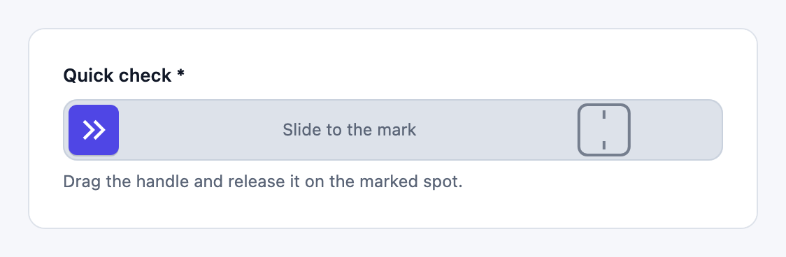

A "slide to the mark" control: a mark sits at a random spot on the track and the person drags the handle onto it.

```ts
{ type: 'humancheck', name: 'human', label: 'Quick check' }
// or: form.add(new HumanCheck(ui, { name: 'human' }))
```

- The mark's position comes from `crypto.getRandomValues` and is drawn only on the canvas. It isn't in the DOM, the
  accessibility outline or the form's values.
- A release only counts when the browser marks the events as **trusted** (events dispatched by page scripts are
  refused), the handle was grabbed (clicking the mark does nothing), and the drag looks like a person's: it takes some
  time, its steps vary and it slows down near the mark.
- A wrong release shakes the handle and moves the mark. After `maxAttempts` (3) wrong releases the check pauses for
  `cooldownMs` (15 s). The error message is the same for every reason, so a bot can't learn which test it failed.
- A solved check expires after `expiresMs` (2 minutes). It is always required, so the form won't submit until it's
  solved.
- Keyboard: Tab to it, use the arrow keys, then press Enter. Screen-reader users can't see the mark, so by default the
  accessible value says "at the mark" while the handle is on it during keyboard use. Set `accessibleHint: false` for a
  stricter check, knowing that blind users then can't complete it; offer them another route.

Options: `prompt`, `maxAttempts`, `cooldownMs`, `expiresMs`, `accessibleHint`, plus the usual `label`, `helperText`,
`info` and `disabled`.

**What it can't do.** The check runs entirely in the browser, and its result isn't sent to your server (`submits`
is `false`), because a client-side result proves nothing to a server. It raises the bar for simple bots and for
scripts that fill forms through the page. It won't stop a bot that drives a real browser with realistic mouse
movement, reads the mark from the canvas pixels, or skips the page and posts to your API directly. Use it alongside
the form proof and timing check, and add Turnstile or hCaptcha where abuse is costly.

---

## 30. Conditional and hidden fields

### 30.1 Showing fields only when they apply

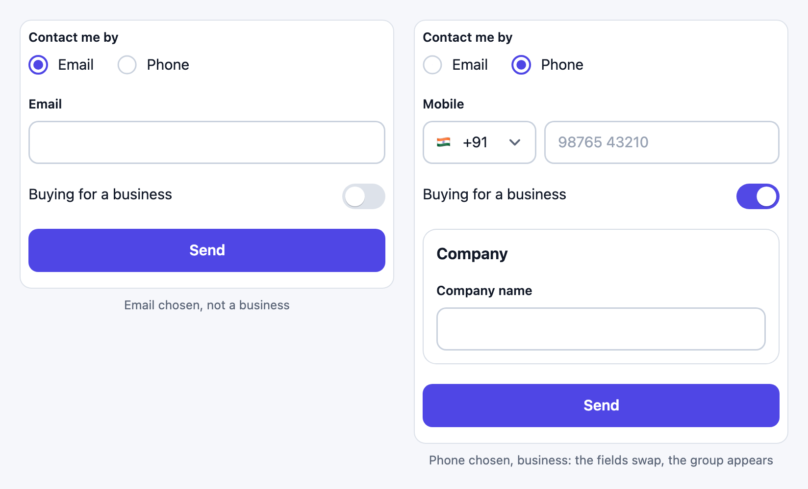

Give any field, group, heading or paragraph a `showIf` rule. It's re-checked after every change.

```ts
fields: [
  { type: 'radio', name: 'contact', label: 'Contact me by', value: 'email',
    options: [{ value: 'email', label: 'Email' }, { value: 'phone', label: 'Phone' }] },
  { type: 'email', name: 'email', label: 'Email', required: true, showIf: { field: 'contact', equals: 'email' } },
  { type: 'phone', name: 'phone', label: 'Mobile', required: true, showIf: { field: 'contact', equals: 'phone' } },

  { type: 'switch', name: 'business', label: 'Buying for a business' },
  { type: 'group', title: 'Company', showIf: { field: 'business', equals: true }, fields: [
    { type: 'text', name: 'companyName', label: 'Company name', required: true },
    { type: 'text', name: 'vat', label: 'VAT number', showIf: { field: 'companyName', filled: true } },
  ] },
]
```

| Condition | Shows when |
| --- | --- |
| `{ field: 'x', equals: v }` / `notEquals: v` | the value is (not) `v` |
| `{ field: 'x', in: [a, b] }` / `notIn: [...]` | the value is (not) one of the list |
| `{ field: 'x', gt: n }`, `gte`, `lt`, `lte` | the value is a number (or numeric text) in range |
| `{ field: 'x', filled: true }` / `empty: true` | the field has (no) value |
| `{ field: 'x' }` | the field has a value |
| `{ all: [...] }`, `{ any: [...] }`, `{ not: c }` | combinations |
| `(values) => boolean` | anything else (not in JSON configs) |

A condition with several operators needs all of them to hold. Dates compare as ISO strings.

While a field is hidden:

- it isn't validated, so a hidden `required` field never blocks submit;
- it's left out of `values()`, `serialize()` and the submitted data;
- it's removed from the screen-reader outline and the Tab order, and its space is given to the fields around it
  (including the other fields in a `row`);
- it keeps its value, which comes back if the field is shown again;
- conditions that depend on it see it as empty, so rules chain naturally.

From code:

```ts
handle.setVisible('phone', false); // hide, whatever its rule says
handle.setVisible('phone', true);  // show, whatever its rule says
handle.setVisible('phone', null);  // back to the rule
handle.isVisible('company');       // false inside a hidden group too
handle.on('fieldvisibility', (e) => console.log(e.name, e.visible));
```

`<pixi-form>` has the same `setVisible()` and `isVisible()` methods, and fires `pixiform-fieldvisibility`.

A `showIf` that names a field that doesn't exist fails when the form mounts, with a clear error.

**On the server:** apply the same rule before validating. For example, require `phone` only when
`contact === 'phone'`, and ignore fields the rule says were hidden. `evaluateCondition()` is exported so a Node server
can reuse the same condition objects.

### 30.2 Hidden fields

A value that is submitted with the form but never shown, like `<input type="hidden">`: a campaign or referral code, a
record id, a plan picked on the previous page.

```ts
{ type: 'hidden', name: 'campaign', value: 'spring-sale' }

// set it from code, e.g. from the URL
handle.get('campaign')!.setValue(new URLSearchParams(location.search).get('utm_campaign'));
```

It accepts a string, number, boolean or `null`. Nothing about it is drawn, focusable or in the accessibility outline,
and unlike an HTML hidden input its value isn't in the page's markup either. `reset()` restores the configured value,
and a `showIf` on a hidden field decides whether it's sent.

Anyone can still change what their browser sends, so treat hidden values as untrusted input on the server. Never use
one for prices, permissions or secrets; look those up on the server from the id instead.

---

## 31. Server-side rendering (Next.js, Remix, Astro…)

PixiFormUI draws forms on a canvas, so the form itself renders in the browser. Everything around it works with
server-side rendering:

- **`pixiformui` is safe to import in server code.** Importing it needs no `window`, `document` or `HTMLElement`, so
  server components, route handlers and SSR builds can import it (for example to share a config, or to use
  `evaluateCondition()`).
- **`mountPixiForm()` runs in the browser.** Call it after the page loads: in `useEffect` (React), `onMounted`
  (Vue), `onMount` (Svelte) or `ngAfterViewInit` (Angular). Called on a server, it throws a clear error.
- **A server-rendered placeholder.** `pixiformSkeleton(config)` from `pixiformui/ssr` (a small separate entry point,
  so it stays out of your browser bundle) returns HTML with the form's title, labels and
  button, sized like the real controls (with `showIf` rules applied to the initial values). Render it inside the
  element you mount on; the form replaces it on its first frame. The page doesn't jump when the form appears, and
  visitors without JavaScript, and search engines, still see what the form asks for. Hidden-field values are never
  printed.

```ts
// On the server (any framework): the placeholder and its CSS
import { pixiformSkeleton, PIXIFORM_SKELETON_CSS } from 'pixiformui/ssr';
const html = `<style>${PIXIFORM_SKELETON_CSS}</style><div id="signup">${pixiformSkeleton(config)}</div>`;

// In the browser
import { mountPixiForm } from 'pixiformui';
mountPixiForm(document.getElementById('signup')!, config); // swaps the placeholder for the form
```

The skeleton uses classes only (no inline styles or scripts), so it works under a strict CSP: put
`PIXIFORM_SKELETON_CSS` in your stylesheet, or in a `<style>` tag with your CSP nonce. It follows the visitor's
light or dark mode, and a `<noscript>` message (`opts.noScriptMessage`) tells visitors without JavaScript that the
form needs it.

### React and Next.js

The React wrapper (`examples/react/src/PixiForm.tsx`) takes a `skeleton` prop. In Next.js, mark it as a client
component (`'use client'` at the top) and render it from any page:

```tsx
// app/SignupForm.tsx
'use client';
import { PixiForm } from './PixiForm';
import { formConfig } from '../src/form';

export function SignupForm() {
  return <PixiForm config={formConfig} skeleton />;
}
```

The server HTML then holds the placeholder; in the browser, the component mounts the form over it. Add
`PIXIFORM_SKELETON_CSS` once, for example in `app/layout.tsx`:
`<style dangerouslySetInnerHTML={{ __html: PIXIFORM_SKELETON_CSS }} />`.

For a complete, working setup, run `npm create pixiformui@latest my-app -- --template next`. It includes route
handlers for the session and sign-up endpoints, with CSRF, encrypted passwords, proof-of-work, idempotency and
validation from the same field definitions as the browser.
